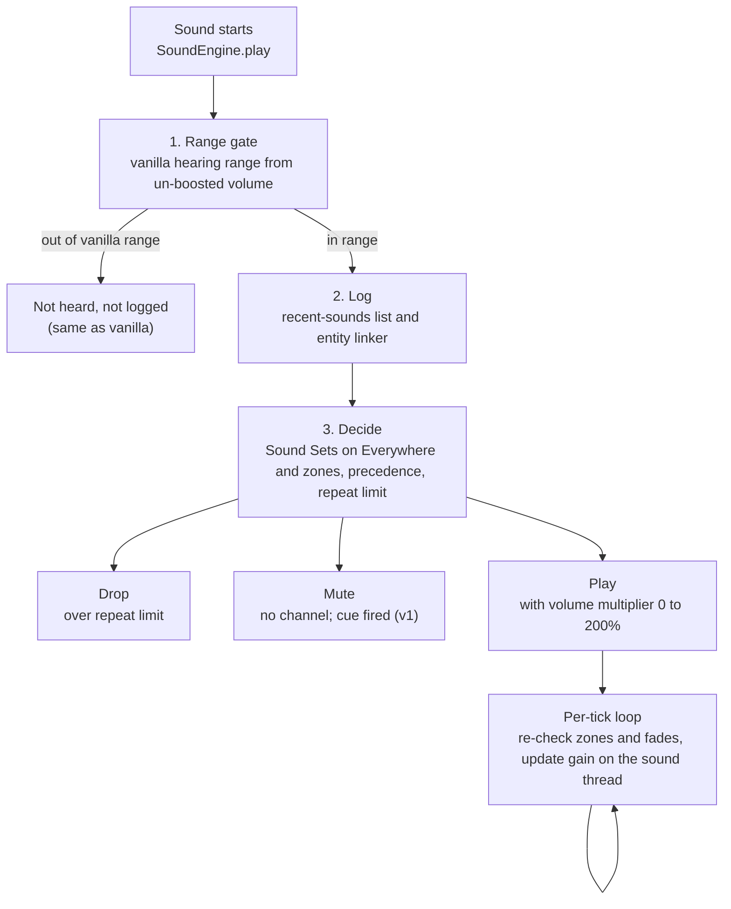

# Sound Sculptor PRD

Nov 8, 2026 · maxismagical, Sciencode

Sound Sculptor is a client-only Fabric mod that lets a player mute, turn down, boost or rate-limit any Minecraft sound, everywhere or only inside areas they draw, without ever hearing more than vanilla allows. This is draft 1 of the full PRD. Every requirement is tagged **MVP**, **v1** or **Future**, and every FR has in-game acceptance criteria.

## Draft status and working assumptions

maxismagical had not yet answered questions on scope, so this draft picks defaults. Each one is listed here and repeated in section 12. Change any of them and the affected sections will be revised.

| # | Assumption | Why this default | Sections affected |
| --- | --- | --- | --- |
| A1 | Initial build supports Minecraft Java 26.2 and 26.3 (decided by maxismagical). Java 26.x ships unobfuscated, so code uses Mojang's official names (e.g. `SoundEngine`, `SoundInstance`). | Matches the decided platform; Fabric dropped Yarn names after the de-obfuscation change. Verified at M0: `SoundEngine.play(SoundInstance)` and `calculateVolume` exist in both versions. | 7, 12 |
| A2 | MVP ships **Sound Sets** (FR-4), the single **Sounds** browser (recently played, full list and search in one tab, FR-1 and FR-3) and **basic fixed zones** (box, Inside mode, hard edge). The alpha is held until Sound Sets and the Sounds browser are done, so they are tested from day 1 (decided 2026-11-11). | Zones are the product's namesake and Sound Sets are how players say what a place sounds like, so a first release without either would miss the main promise. | 5, 10 |
| A3 | Volume in MVP is 0–100%. Boost to 200% arrives in v1. | Boost needs the riskiest engine change (raising the gain clamp without raising range). | 5, 10 |
| A4 | Each server or world has exactly one profile, created automatically (MVP). Copying settings from another server and import/export are v1. | Fixed zones need a server/world key from day one; full profile management is a lot of UI. | 5, 10 |
| A5 | Distances in the recently played list are shown as coarse bands (Close, Near, Far), not exact block counts. | Exact distance to an unseen mob is more than vanilla subtitles give. See FR-1.4. | 5, 8 |
| A6 | Zone checks run when a sound starts, then every client tick (20 times a second) for sounds that are still playing. | Handles minecarts, entity-bound sounds and long sounds without per-frame cost. | 5, 7 |
| A7 | The default hotkey that opens Sound Sculptor is **;** (semicolon). | Free in vanilla and in the 36 most-downloaded Fabric mods (K clashed with Iris, checked at M0); rebindable in Controls. | 5 |
| A8 | English (en\_us) at launch, with every string in a language file ready for community translation. | Keeps launch small; localization is cheap to add later if planned now. | 9 |

## 1. Summary and problem statement

**Summary.** Sound Sculptor gives players per-sound control over what they hear: mute, volume from 0% to 200%, repeat limits, and visual cues when a muted sound plays. Settings are kept in named, reusable **Sound Sets** ("Farm animals", "Mob farm extras"): each set lists sounds and groups of sounds, each with its own settings. A set is attached to **Everywhere** or to zones placed at fixed coordinates or around the player, and one set can be attached to many places at once. It runs on the client only, so it works on vanilla servers, Realms and singleplayer.

**Problem.** Vanilla Minecraft offers only about ten volume sliders: Master plus one per sound category (Music, Jukebox/Note Blocks, Weather, Blocks, Hostile Creatures, Friendly Creatures, Players, Ambient/Environment, Voice, and others; checked at M0, 26.2 and 26.3 both have Master, Music, Jukebox/Note Blocks (`record`), Weather, Blocks, Hostile Creatures, Friendly Creatures (`neutral`), Players, Ambient/Environment, Voice/Speech and UI). A *category* is a broad bucket; a player cannot silence one sound (villager "hmm") without silencing every friendly mob. This causes three recurring pain points:

- **Noise in farms and bases.** Iron farms, villager trading halls, mob farms and redstone clocks produce hundreds of sounds per second. Players turn whole categories off and lose sounds they need, such as creeper hiss or a player's footsteps.
- **Sensory and hearing needs.** Players with sound sensitivity or sensory overload need specific harsh sounds removed (explosions, ghast screams, glass breaking). Players with hearing loss need some quiet sounds louder, which vanilla cannot do beyond 100%.
- **Location matters.** A sound that is fine in the wild is unbearable next to a farm. Players want "quiet near my farm, normal everywhere else".

Existing sound mods are mostly category sliders or global mute lists, and few address the fair-play question. Sound Sculptor's difference is **per-sound + per-place control with a strict no-information-advantage guarantee**, so it can be allowed on servers that ban cheat or "info" mods.

Terms used here (*sound event*, *sound instance*, *category*, *client-only*, *Fabric*, *Mixin*) are explained in the Glossary (section 13).

## 2. Target users and personas

Five personas drive the requirements. The accessibility persona is a first-class persona: when trade-offs conflict, their needs win over convenience features.

| Persona | Who they are | What they need from Sound Sculptor | Key FRs |
| --- | --- | --- | --- |
| **Tess, technical/farm player** | Runs iron farms, villager halls and redstone builds on a survival SMP. | Silence or rate-limit farm noise only near the farm; keep danger sounds. No FPS loss with 300+ sounds per second. | FR-1, FR-4, FR-6, FR-8, FR-9 |
| **Sam, streamer/recorder** | Records or streams gameplay; viewers complain about repetitive noise. | Per-sound volume for a clean mix; settings that follow each server automatically; stable behavior on stream. | FR-5, FR-11, FR-12 |
| **Alex, accessibility needs** | Has sound sensitivity (misophonia or sensory overload) or partial hearing loss; may use a screen reader or keyboard only. | Remove specific harsh sounds; boost quiet ones up to 200%; still *know* a muted sound happened via cues; every screen usable by keyboard and narrator. | FR-5, FR-7, FR-13 (all UI), section 6.4 |
| **Bea, builder** | Builds for hours in creative or on a build server. | A calm Everywhere set that quiets ambient and mob noise while they build, easy to toggle on and off; zone outlines that don't clutter the view. | FR-4, FR-10 |
| **Mo, multiplayer regular** | Plays on several servers, some with strict mod rules. | Settings that follow each server automatically; a clear statement that the mod gives no advantage, so admins allow it. | FR-11, section 8 |

## 3. Goals, non-goals and success metrics

### 3.1 Goals

- **G1. Per-sound control.** Any sound event, including sounds from other mods and resource packs, can be muted, set from 0% to 200%, or rate-limited.
- **G2. Per-place control.** The same controls apply inside or outside zones at fixed coordinates or around the player, and one Sound Set can be reused in many places without being rebuilt.
- **G3. Find any sound in under 30 seconds.** A player who just heard a sound can find and mute it from the Sounds tab's recently played filter without knowing its ID.
- **G4. Accessible by default.** Every feature works with keyboard only, at every GUI scale, with narrator support where vanilla has it, and never relies on color alone.
- **G5. Fair play.** No feature gives information beyond vanilla audio and subtitles (the core principle).
- **G6. Invisible cost.** No measurable FPS loss in normal play; under 1 ms of added work per frame in a 300-sounds-per-second stress test.
- **G7. Maintainable across versions.** Version-specific code is isolated so a Minecraft update touches a small, known set of files.

### 3.2 Non-goals

- **No information advantage over vanilla.** Sound Sculptor never reveals a sound, entity, position or direction the player could not already hear or see in vanilla at vanilla range. This is a hard rule, not a preference.
- No server-side component in 1.0, and no features that need one (e.g. syncing zones between players). A companion server policy mod is a Future idea (section 10.3).
- No NeoForge, Forge or Quilt-specific builds. Quilt may load Fabric mods but is not tested.
- No sound replacement, pitch editing, equalizer, reverb or audio effects.
- No change to any sound's hearing range (the distance at which it can be heard at all). Loudness can go down or up; range never goes up.
- No dependency on a config library (Cloth Config, YACL, owo-lib). Screens are built from scratch.
- No Bedrock Edition support. No controls for vanilla-covered sounds that already have their own slider, such as background music and UI clicks (see section 5).

### 3.3 Success metrics

| Metric | Target | How measured |
| --- | --- | --- |
| Adoption | 5,000 combined downloads on Modrinth and CurseForge within 3 months of v1 | Platform dashboards |
| Stability | Fewer than 1 confirmed crash report per 1,000 downloads per release | GitHub issues labeled `crash` |
| Fair play | 0 confirmed reports of the mod revealing information beyond vanilla | Issues labeled `fair-play`; each is triaged within 7 days |
| Performance | Hot-path cost under 5 microseconds per sound on average; under 1 ms per frame at 300 sounds/second | Built-in diagnostics readout (FR-13) during the noisy-farm test |
| Findability | A new tester mutes a named sound from the Sounds tab in under 30 seconds, in 4 of 5 attempts | Moderated test with 5 players before v1 |
| Accessibility | All 7 core tasks (section 6.4) completed keyboard-only by a tester | Pre-release accessibility checklist |
| Server acceptance | At least 3 servers with client-mod allowlists add Sound Sculptor within 6 months | Self-reported, tracked in the README |
| Version freshness | A compatible Sound Sculptor release within 7 days of each official Minecraft release | Release dates on Modrinth vs Mojang's release date |

## 4. User stories and use cases

Each story maps to the FRs that satisfy it. Release tags show when the story first works end to end.

| ID | As a… | I want to… | So that… | FRs | Release |
| --- | --- | --- | --- | --- | --- |
| US-1 | farm player | open a list of sounds I just heard and mute one with one click | I can silence a sound without knowing its ID | FR-1, FR-4, FR-5 | MVP |
| US-2 | farm player | mute all villager sounds only within 24 blocks of my trading hall | the hall is quiet but villagers elsewhere still sound normal | FR-4, FR-8, FR-9 | MVP |
| US-2b | player with two bases | build one Sound Set for the farm animals both my bases share, plus one set per base for its own sounds, and attach them | I set up the shared sounds once, and changing them later changes both bases | FR-4, FR-8.6 | MVP |
| US-2c | player | see, while editing a Sound Set, every place it is attached to | I know what else changes before I save | FR-4.9 | MVP |
| US-3 | farm player | cap villager "hmm" sounds to 3 per second | the hall is calmer without going silent | FR-6 | v1 |
| US-4 | player with hearing loss | boost quiet sounds like footsteps to 180% | I can hear them at all | FR-5 | v1 |
| US-5 | player with sound sensitivity | mute explosions and still see a cue saying one happened | I stay safe without the shock | FR-5, FR-7 | v1 |
| US-6 | builder | attach a "Calm building" set with ambient and mob sounds at 30% to Everywhere and turn it on while I build | my build sessions are calm wherever I fly | FR-4, FR-8.10 | MVP |
| US-7 | player | look at a mob and see the sounds it just made | I can mute the parrot that keeps imitating, without searching | FR-2 | v1 |
| US-8 | player | search "villager\|zombie" and see all matching sound IDs, narrowing as I type | I can find a family of sounds and add it to a Sound Set at once | FR-3, FR-4 | MVP (plain/AND/OR), Future (regex) |
| US-9 | multiplayer regular | have my settings switch automatically when I join each server | I don't redo setup every session | FR-11 | MVP |
| US-10 | streamer | export my profile and send it to a friend | they get the same mix, including the Sound Sets it uses (fixed zones included if they play on the same server) | FR-11 | MVP |
| US-11 | keyboard-only or narrator user | reach and change every control without a mouse | the mod is usable for me | FR-12, 6.4 | MVP |
| US-12 | player | turn all Sound Sculptor effects off with one key | I can compare with vanilla or recover from a bad setting | FR-13 | MVP |
| US-13 | server admin | read a clear fair-play statement | I can decide to allow the mod | section 8 | MVP |
| US-14 | player | see every Sound Set and zone that affected a sound and which one won | I can fix a setup that isn't doing what I expect | FR-14 | MVP |

**Example flow (US-1 + US-5; the cue part works from v1).** Alex hears a loud glass-breaking sound. They press **;**, the Sounds tab is already open with the Recently played filter on, and the top row reads "Glass breaks · minecraft:block.glass.break · Blocks · ×2 · Near". They press the Mute button on that row and tick "Show cue". The mute goes into the Quick changes set of Everywhere (FR-4.10). The next time glass breaks, no sound plays and a cue reads "(muted) Glass breaks" in the subtitle area.

**Example flow (US-2b).** Tess has a main base and a mob farm in different places. On the Sound Sets tab she makes "Farm animals" and adds cats, dogs, cows and chickens from the Sounds picker, muting the chickens and setting cows to 30%. She makes "Main base extras" and "Mob farm extras" the same way. In the Zones tab she attaches "Farm animals" and "Main base extras" to the main base zone, and "Farm animals" and "Mob farm extras" to the farm zone. A week later she softens dogs in "Farm animals": the set editor shows "Attached to: Main base, Mob farm", and after Save both bases change.

## 5. Functional requirements

Fourteen functional requirement groups, FR-1 to FR-14. Each has numbered sub-requirements, a release tag, a **Fair play** statement explaining how it follows the core principle, and acceptance criteria (AC) written as in-game checks. Tick the AC boxes as you test.

Two definitions are used throughout:

- **Vanilla hearing range** of a sound = `max(vanilla volume, 1.0) × attenuation distance` (attenuation distance is 16 blocks for almost every sound). This is the distance vanilla itself uses to decide whether to notify subtitles. It is always computed from the *un-modified* vanilla volume, never from Sound Sculptor's volume. Verify the exact formula against 26.2 at M1.
- **Positional sound** = a sound instance with linear attenuation that is not relative to the listener. Everything else (music, UI clicks, most sounds attached to the player's own head) is **non-positional**.

**Vanilla-covered sounds are out of scope.** A sound is *vanilla-covered* when a vanilla slider already controls that kind of sound and nothing else. Background and menu music (Music slider) and interface sounds such as button clicks (UI slider; 26.2 and 26.3 both have one) and the Voice/Speech slider's sounds are the excluded set. Sound Sculptor leaves these sounds untouched. They do not appear in the Sounds tab or the entity inspector, no Sound Set entry matches them (not even the group `*`), and they produce no cues. Sounds in a broad category that holds many different sounds stay in scope. Jukebox records and note blocks are one example (shared slider). Mobs, blocks and weather are others. Checked at M1: 26.2 and 26.3 both have separate Music, UI and Voice/Speech categories (see Q8).

How the check works: a sound is excluded by the category it plays in (Music, UI, Voice/Speech). Search cannot know a sound's category in advance, so it hides IDs under `minecraft:music.*` and `minecraft:ui.*`, plus any modded ID that has already played in an excluded category this session.

### FR-1 Sounds browser: recently played (MVP)

The main entry point. **One Sounds browser is used everywhere**: it is the top-level **Sounds** tab (replacing the separate Recently Played and Search tabs), and the same view opens as the **picker** when sounds are added to a Sound Set (FR-4.7). It shows the full list of sounds, narrowing as the player types (FR-3), with a **Recently played** filter that shows only the sounds the player just heard, with the columns below. FR-1 covers the recently played filter and the quick actions; FR-3 covers the full list and the search syntax.

- **FR-1.0** The browser has one search field, a **Recently played** filter toggle (on by default when the Sounds tab opens; the filter stays as the player left it while the game runs), and a result count. With the filter on, the list holds the recently played sounds that match the search text, with the FR-1.2 columns; with it off, every known sound that matches (FR-3.1). An empty search field shows everything the filter allows.
- **FR-1.1** Sound Sculptor records every sound the client starts or would have started (including sounds Sound Sculptor muted or limited) **if** it is non-positional, or it is positional and the listener is within its vanilla hearing range at the moment it starts. Vanilla-covered sounds (Music, UI, Voice/Speech) are never recorded.
- **FR-1.2** Rows are grouped by sound ID. Each row shows: subtitle text (or the ID if the sound has no subtitle), full ID, category, play count in the last 3 minutes, time since last play ("2s ago"), distance band (FR-1.4), and a status label: Playing, Muted, Limited, Boosted, or "Zone: \<name>". Status uses text and an icon, never color alone.
- **FR-1.3** The recently played log keeps the last 3 minutes, up to 200 distinct IDs. With the filter on, sort by most recent (default), play count, or name. A Pause toggle (key **P** while the list is focused) freezes the list for reading.
- **FR-1.4** Distance is shown as a band, not a number: **Close** (4 blocks or less), **Near** (4 to 16), **Far** (more than 16, only possible for loud sounds). No direction and no coordinates are shown. Non-positional sounds show "Around you".
- **FR-1.5** Each row has quick actions: Mute/Unmute, Level… (opens a slider pop-up for the level, FR-4.3), Limit (opens count and window fields, v1), Cue on/off (v1), Why? (FR-14), and **Add to set…**, which adds the sound, or one of its groups (the "Like this" suggestions of FR-4.8, e.g. `minecraft:entity.villager.*`), to a chosen library Sound Set or a new one. An **Apply to** selector chooses the place the quick actions change: Everywhere or one of the zones the player is standing in. Quick-action buttons always show the sound's **actual** state at that place (what it gets now from every set attached there, e.g. Unmute when a library set mutes it). Pressing one edits the sound's single-sound entry in that place's **Quick changes** set (FR-4.10), creating the set or entry if needed. Because Quick changes is pinned first in the place, the change always takes effect there: Mute mutes, and Unmute on a sound muted by a library set writes a "Not muted" entry. Quick actions apply at once with a 5-second Undo toast (FR-12.5); Undo puts the Quick changes entry back as it was. "Edit…" opens that entry.
- **FR-1.6** The list refreshes at most 4 times per second. The Sounds tab does not pause a singleplayer game, so sounds keep arriving while it is open.
- **FR-1.7 Picker mode.** Opened from a Sound Set (FR-4.7), the browser has the same search field and filter, but each row has a checkbox instead of quick actions, plus **Like this…** to pick one of the sound's groups. The footer says how many are picked and has **Add** and Cancel. Add creates one single-sound entry per picked sound and one group entry per picked group, with no settings yet (the player sets them in the set editor; FR-4.3). Sounds already in the set are marked "In this set" and cannot be picked again (proposed).

**Fair play.** Only sounds the player was in vanilla range to hear are listed, which is the same set vanilla subtitles would show. Distance bands are coarser than the loudness the player hears; no direction or position is shown. Risk flag: some strict servers may still object to any distance hint. Setting "Show distance" (default on) hides the column entirely.

**Acceptance criteria**

- [ ] Stand near a villager with the Recently played filter on; within 5 seconds of it making a sound, a row "minecraft:entity.villager.ambient" (or similar) appears with category Friendly Mobs (vanilla's name for the `neutral` category; Sound Sculptor shows vanilla's translated category names) and band Close or Near.
- [ ] Walk 30 blocks from all villagers and wait 10 seconds: no new villager rows appear and existing counts stop increasing.
- [ ] Click Mute on a row: the next play of that sound is silent, the row status changes to "Muted", and Everywhere's Quick changes set now has a muted entry for that sound. This holds whatever other sets are attached to Everywhere, even one that sets the sound to "Not muted".
- [ ] Attach a library set that mutes cows to Everywhere: a cow row shows Unmute. Click it: the next cow sound plays, Everywhere's Quick changes set has a "Not muted" cow entry, and the library set is unchanged. Undo: cows are muted again.
- [ ] Stand inside zone A, set Apply to to A and click Mute: the entry goes into A's Quick changes set, not Everywhere's.
- [ ] Type `villager` with the filter on: only recently played villager sounds remain; turn the filter off: every known villager sound is listed.
- [ ] With the list open in singleplayer, the world keeps running (mobs move, sounds keep arriving).
- [ ] Toggle "Show distance" off: the distance column disappears.
- [ ] With 300 sounds per second (noisy-farm test), FPS with the list open is within 5% of FPS with it closed.
- [ ] From a Sound Set, open the picker, tick three cow sounds and Add: the set gains three single-sound entries; opening the picker again marks them "In this set".

### FR-2 Point-at-entity sound inspector (v1)

Look at a mob or other entity and see the sounds it recently made, with the same quick actions as FR-1.

- **FR-2.1** Pressing the Inspect key (default unbound; also a button on the main screen) selects the entity under the crosshair. Selection uses a line-of-sight ray up to 32 blocks that stops at solid blocks. Entities invisible to the player in vanilla are never selected.
- **FR-2.2** For each entity within vanilla hearing range, Sound Sculptor remembers its last 20 sounds from the last 30 seconds (at most 256 entities tracked).
- **FR-2.3** Sounds are linked to entities in two ways, and each link is labeled:
  - **Linked** (certain): the sound instance itself is attached to the entity, or the server sent it as an entity sound with the entity's ID.
  - **Likely** (guessed): a plain positional sound that started within 1.0 block of the entity's position on that tick. Candidates whose type matches the sound ID (`entity.villager.*` and `minecraft:villager`) are preferred. If two candidates are within 0.25 blocks of each other, the link is marked "Uncertain".
- **FR-2.4** If no sounds are linked to the entity, the inspector says "No sounds linked yet" and shows nothing else. There is no fallback list; the Sounds tab's Recently played filter covers unlinked sounds.
- **FR-2.5** Accuracy target: in the 10-villager pen test (section 11), at least 90% of Likely links are correct and 0 links point to an entity outside vanilla hearing range.

**Fair play.** Only an entity the player can see, through clear line of sight, can be inspected, and only sounds the player could hear are shown. The inspector never highlights or lists entities behind walls. It adds a name to a sound the player heard from a mob they are looking at, which vanilla subtitles already do ("Villager mumbles").

**Acceptance criteria**

- [ ] Look at a villager 10 blocks away and press Inspect: its recent sounds appear, each labeled Linked, Likely or Uncertain.
- [ ] Look at a villager behind a glass-free stone wall: nothing is selected.
- [ ] Look at a minecart moving on rails: its rolling sound is labeled Linked.
- [ ] Look at a mob that made no sound: the panel shows "No sounds linked yet" and no other sounds.
- [ ] Pen test: at least 18 of 20 sampled Likely links name the right villager.

### FR-3 Sounds browser: full list and search (MVP: plain text, AND, OR; Future: regex)

Browse every sound the game knows by name or ID, in the same Sounds browser as FR-1 (with the Recently played filter off). The list narrows as the player types.

- **FR-3.1** The full list covers every sound ID the client knows: the sound event registry plus every ID defined in `sounds.json` files of loaded resource packs and mods. The list is rebuilt after a resource reload (F3+T). Vanilla-covered sounds are hidden.
- **FR-3.2** Each result shows ID, subtitle text in the current language (if any), and "Seen as: \<category>" if the sound has played this session. (A sound event has no fixed category; the code that plays it picks one.)
- **FR-3.3** Results have the same quick actions as FR-1.5 (or the picker checkboxes of FR-1.7), plus Preview (Future, after 1.0), which plays the sound once at the player's own position at 100%.
- **FR-3.4** Results update 150 ms after the player stops typing and show a count ("42 sounds"). An empty field lists every known sound.
- **FR-3.5** The exact syntax is below; it applies with the Recently played filter on or off. A "?" help button next to the field shows the table's examples. Matching is case-insensitive and looks at both the ID and the subtitle text, except regex, which looks at the ID only.

| You type | It means | Example matches |
| --- | --- | --- |
| `villager` | contains "villager" | `minecraft:entity.villager.ambient` |
| `villager hurt` | contains **all** words (AND) | `minecraft:entity.villager.hurt` |
| `villager\|zombie` | contains **either** (OR) | villager and zombie sounds |
| `villager hurt \| zombie hurt` | `\|` splits into groups first; spaces inside a group mean AND | hurt sounds of villagers or zombies |
| `-ambient` | must **not** contain "ambient" | combine: `villager -ambient` |
| `"glass break"` | exact phrase, spaces included | subtitle "Glass breaks" (contains the phrase); not "break glass" |
| `block.*.step` | `*` = any characters | `minecraft:block.stone.step` |
| `/entity\.(cow\|pig)\..*/` | regex between slashes (Future), ID only, max 100 characters | cow and pig sounds |

- **FR-3.6** (Future) An invalid regex shows a message under the field in plain words ("Missing closing bracket") and keeps the previous results. A regex that takes longer than 50 ms over all IDs is stopped and reported as "too complex".
- **FR-3.7 (MVP)** The "Apply to" selector (FR-1.5) works the same with the filter off: a quick action on a search result edits the sound's entry in the Quick changes set of Everywhere or of a zone the player is standing in.

**Fair play.** Search lists sound IDs, which are public game data. It shows nothing about the world.

**Acceptance criteria**

- [ ] With the Recently played filter off and an empty field, every known sound is listed with a count. Type `villager`: the list narrows to villager-related sounds as you type, with a count.
- [ ] Type `villager|zombie`: both families appear; `villager zombie` returns only sounds whose ID or subtitle has both words (the zombie villager family); `villager cow` returns none.
- [ ] Type `villager -ambient`: no result contains "ambient".
- [ ] Install a resource pack that adds a new sound in `sounds.json`, press F3+T, search its name: it appears.
- [ ] (v1) Type `/entity\.(cow|pig)\..*/`: only cow and pig sounds; type `/(/`: a readable error appears and the game does not freeze.
- [ ] Every control on the screen can be reached and used with Tab, arrows and Enter.
- [ ] With the filter off, stand in a zone, set Apply to to that zone, find `villager`, and Mute a result: the entry appears in that zone's Quick changes set, not in Everywhere's.

### FR-4 Sound Sets (MVP)

A **Sound Set** is a named, reusable bundle of sound settings, such as "Farm animals" or "Mob farm extras". It lists **entries**: single sounds and groups of sounds, each with its own settings. Sets live in one **library** shared by every world and server. A set does nothing until it is **attached** to a **place**: **Everywhere** (FR-8.10) or a zone. Each place has an ordered list of attached sets, and one set can be attached to many places, in many worlds, at once. Sound Sets replace the earlier "rules" (a global rule list plus one rule list per zone): Everywhere's attached sets do what the global rules did, and a zone's attached sets do what its rules did.

The open questions raised while drafting Sound Sets were decided by the project owner on 2026-11-11 (Decisions Log).

- **FR-4.1 Entries.** An entry targets either **one sound** (an exact sound ID, no `*`) or a **group** (a pattern, below). Each entry has its own settings: Mute, Level, Repeat limit and Cue, and can be turned off without deleting it. A setting left as "Unchanged" means this entry does not set it, so it is left to other entries, sets or places (FR-4.5, FR-9). Level is 0% to 200%: up to 100% in MVP, and above 100% (boost) from v1 with the FR-5.4 safeguards. Repeat limit (FR-6) and Cue (FR-7) are offered once their milestones ship (M11, M9); until then an entry's stored limit and cue are kept unchanged.
- **FR-4.2 Group patterns.** Format `namespace:path`, where `*` matches any run of characters, including none and including dots. No other special characters. A pattern with no `:` matches any namespace: `block.*.step` is the same as `*:block.*.step`. A pattern must match the whole ID, so `villager` alone matches nothing; use `*villager*`. The group `*` means every sound in scope (in a zone: every positional sound). Allowed characters: `a-z 0-9 _ . - / : *`; uppercase is converted to lowercase; anything else shows an inline error and blocks Save.
- **FR-4.3 Set editor.** The set editor shows the set's name, its entries as a list (each row: the sound's name or the group's pattern, a summary such as "✖ Muted" or "▶ Level 30%", and On/Off, Edit and Delete buttons), and **Add sounds…**, which opens the Sounds picker (FR-1.7), and **Type a pattern…**, which opens the entry editor for a new entry with a typed pattern or a plain-word search (FR-4.8). Editing an entry shows Mute (Unchanged, Muted, Not muted), Level (Unchanged or a value, slider in 5% steps, arrows ±5%, Shift+arrow ±1%, typed value), Limit and Cue (when available), and for a group, a live preview "Matches N sounds" with the matching list, from the same ID set as FR-3.1. "Not muted" lets an entry override a broader entry that mutes. The editor uses Save and Cancel (FR-12.4); nothing changes in game until Save.
- **FR-4.4** Patterns match against the ID of each sound as it plays, so sounds added later by mods or resource packs match without a restart. Vanilla-covered sounds never match.
- **FR-4.5 Which entry wins.** Decided per setting: loudness (mute and level together, so an entry that sets either one competes for both), limit, and cue.
  1. **Within one set:** a single-sound entry beats any group. Between groups, more literal (non-`*`) characters beat fewer, then fewer `*` beat more, then the entry higher in the set beats a lower one. Only entries that are on and set the property take part.
  2. **Between sets attached to the same place:** settings layer. The set higher in that place's list wins a property only if it has an entry that sets that property for the sound; every property it leaves unchanged falls through to the next set down, and so on. The place's Quick changes set is always first (FR-4.10).
  3. **Between places:** FR-9.
- **FR-4.6** The entry editor shows "Partly overridden by: \<entry>" when a more specific entry in the same set takes over one of its settings, and the trace (FR-14) shows overrides between sets and places.
- **FR-4.7 Library and the Sound Sets tab.** The Sound Sets tab lists every set in the library with its name, entry count and where it is used ("3 places in this world, 2 other worlds"). Actions: New set, Edit, **Duplicate** (an independent copy named "\<name> (copy)", attached nowhere), Rename, and Delete. Set names are unique in the library (proposed: a clashing name gets " (2)" added). The library holds up to 256 sets and each set up to 512 entries.
- **FR-4.8 Find a sound or group.** Sounds are added through the Sounds picker (FR-1.7). For each sound, **Like this…** lists the sound's groups, closest first (e.g. `minecraft:entity.villager.*`), each with how many sounds it matches. A group's pattern can also be typed in the entry editor; typing plain words there (text with neither `:` nor `*`, which could never be a useful pattern) searches for sounds instead of showing a pattern error, using the Search syntax (FR-3.5), with **This sound** and **Like this** buttons on each result.
- **FR-4.9 Linked sets and "Attached to".** Sets are linked, not copied: editing a set changes it everywhere it is attached, in every world and server. The set editor always shows an **Attached to** panel: each place in the current world or server (Everywhere, zone names) that uses the set, and "Also used in N other worlds or servers" with their names in a tooltip. When a set is used in more than one place, Save shows that list again in the confirmation ("This changes Main base, Mob farm and 1 other world") (proposed). From the panel the player can attach the set to another place in this world or detach it. **Duplicate** is how to make a variation that does not affect the other places. Counting uses in other worlds must not block the game thread (how it is counted is left to the builder).
- **FR-4.10 Quick changes.** Every place can have one automatic **Quick changes** set. Quick actions (Sounds tab rows, the entity inspector, the trace) edit single-sound entries in the Quick changes set of the place chosen in Apply to, creating the set on first use. A Quick changes set belongs to its place in its profile and is not in the library. It is **pinned first** in its place's list: it cannot be moved down and no set can be moved above it, so a quick action always wins at that place for the settings it sets (FR-4.5). Quick-action buttons show the sound's actual state at the place, so pressing one always does what it says: Mute writes a muted entry, and Unmute on a sound muted by any set at that place writes a "Not muted" entry (Unmute on a sound muted only by Quick changes just clears that setting). **Save to library** gives the set a name and turns it into a normal library set, still attached in the same place, directly below the pinned position; the next quick action at that place starts a new Quick changes set, again pinned first.
- **FR-4.11 Deleting a set.** Delete opens a warning before anything changes. It lists every place in **this** profile that the set is attached to (Everywhere and each zone by name). It then warns that the set will also be removed from every **other** server and world profile that uses it, and lists those profiles by display name only, without their zones ("Also removed from: Hypixel Skyblock, Creative test world"). The player must confirm; Cancel changes nothing. The set is removed from the library and from every place in every world. Places in the loaded profile are updated at once; every other profile is cleaned up when it next loads: a reference to a set that is no longer in the library is dropped, and a one-time note says so ("'Farm animals' was deleted, so it was removed from Main base"). There is no lasting "missing set" state (builder's call).

**Fair play.** Sound Sets only choose which sounds the player's own settings change.

**Acceptance criteria**

- [ ] A set with group `minecraft:entity.villager.*` set to Mute, attached to Everywhere: all villager sounds are silent; wandering trader sounds are not.
- [ ] Group `*:block.*.step` at 50%: footsteps on stone, wood and a modded block are all quieter.
- [ ] In the same set, add single sound `minecraft:entity.villager.ambient` at 100%: villager ambient sounds play; other villager sounds stay muted; the group entry shows "Partly overridden by…".
- [ ] Type `Minecraft:Entity.Cow.*` as a group: it becomes lowercase. Type `entity.cow.#`: error shown and Save disabled.
- [ ] Turn an entry off: its effect stops immediately after Save; turn it on: the effect returns.
- [ ] Build "Farm animals" (cows 30%, chickens muted) and attach it to zones Main base and Mob farm: cows are quieter and chickens silent in both. Edit "Farm animals" from either zone, set cows to 60% and Save: both zones change; the editor showed "Attached to: Main base, Mob farm" before Save.
- [ ] Duplicate "Farm animals", change the copy's cows to 10% and attach it only to Mob farm in place of the original: Main base is unchanged.
- [ ] Attach "Farm animals" in a second world: the Sound Sets tab and the set editor show it used in 1 other world.
- [ ] A place with set A (cows 20%) above set B (cows 80%): cows play at 20%; move B above A: 80%.
- [ ] With a Quick changes set and two library sets on Everywhere, the Quick changes line has no move buttons, and the set below it cannot be moved above it.
- [ ] Mute a cow from the Sounds tab, then Save to library as "Cow quiet": "Cow quiet" appears on the Sound Sets tab, still attached to Everywhere; the next quick mute creates a new Quick changes set.
- [ ] Delete a set used in two zones here and in a second world: the warning lists both zones of this profile by name and names the second world's profile without listing its zones; Cancel changes nothing; after Delete, neither zone changes cows any more; joining the second world shows a one-time note and its place no longer lists the set.
- [ ] (M8d) In an entry editor, type `villager hurt`, pick "Villager hurts", choose This sound: the entry is `minecraft:entity.villager.hurt` and the preview says "Matches 1 sound". Choose Like this on a cow sound: the group is `minecraft:entity.cow.*` and the preview lists only cow sounds.

### FR-5 Mute and volume, 0–200% (MVP: mute and 0–100%; v1: boost to 200%)

- **FR-5.1 (MVP)** Mute: the sound produces no audio. Mute is separate from the volume value, so unmuting restores the previous volume.
- **FR-5.2 (MVP)** Level per Sound Set entry from 0% to 100%. The slider moves in 5% steps; arrow keys ±5%, Shift+arrow ±1%; the number can be typed directly.
- **FR-5.3 (MVP)** Final loudness = vanilla loudness (including the Master and category sliders) × the winning entry's level. Master at 0% still silences everything.
- **FR-5.4 (v1)** Boost: level from 101% to 200%. Above 100%, the slider shows a warning icon and the text "May distort. Protect your hearing." The first time a profile uses a level above 100% (setting one, attaching a set that has one, or importing or copying one in), a dialog explains clipping and hearing safety and needs a confirm. The narrator reads the warning. Because sets are shared, a library set with a boosted entry still asks once in each profile it is attached in.
- **FR-5.5 (v1)** Boost changes loudness only. The vanilla hearing range, every range check (subtitles, cues, recently played list) and the distance fade-off curve are calculated from the un-boosted vanilla volume. At the edge of vanilla range a boosted sound is silent, exactly as in vanilla.
- **FR-5.6 (v1)** Final gain is capped at 2.0 (200% of vanilla full volume), however the multipliers combine.

**Fair play.** Mute and turn-down only remove information. Boost makes a sound louder only where it is already audible in vanilla; the AC below prove the range does not grow.

**Acceptance criteria**

- [ ] Mute `minecraft:entity.cow.ambient`: cows are silent; unmute: they return at the earlier volume.
- [ ] Set a cow entry to 25%: cows are clearly quieter than sheep at the same distance.
- [ ] Set Master to 0%: nothing plays, even with a 200% entry.
- [ ] (v1) Set an entry to 150%: the warning text and icon appear; the confirm dialog appears once per profile. Attach that set in a second world: the dialog appears there too, once.
- [ ] (v1) **Boost-range test** (section 11.3): with villagers at 200%, the farthest distance at which a villager is audible is the same as with the mod bypassed (within 1 block).
- [ ] (v1) With villagers at 200%, the recently played list and cues stop listing villager sounds at the same distance as with 100%.

### FR-6 Repeat limiting (v1)

Cap how often a sound or group can play, e.g. "at most 3 villager 'hmm' sounds per second". Plays over the cap are dropped.

- **FR-6.1** An entry's limit has a count N (1 to 100) and a window W (50 ms to 10 s, default 1 s).
- **FR-6.2** **Sliding window.** A new play is allowed if fewer than N plays counted by the same counter started in the last W milliseconds. Otherwise it is dropped. Time is real time, not game ticks, so lag does not change the cap.
- **FR-6.3** Only allowed plays are counted. Dropped plays do not count, so a steady stream settles at exactly N per window instead of going silent.
- **FR-6.4** **Shared count (default):** one counter per entry covers every sound the entry matches (all villagers together). Counters are kept per place: a set attached to two places has a separate counter for the same entry in each place, so a limit always applies to what the player hears at that place.
- **FR-6.5** **Per-source option:** one counter per source position, rounded down to the block the sound starts in. Two villagers in different blocks count separately. Each entry tracks up to 1,024 positions per place; the least recently used is forgotten first.
- **FR-6.6** Looping and long sounds count once, when they start. A sound that is already playing is never cut off by a limit.
- **FR-6.7** When Everywhere and a zone (or two zones) both set a limit for a sound, only the winning entry's limit applies (FR-9). Each counter only counts sounds its entry actually decided. A fade zone's limit applies only where the zone's fade weight is 0.5 or more.
- **FR-6.8** Dropped plays show as "Limited" (with a dropped count) in the recently played list and never produce a cue.

**Fair play.** Limiting only removes sounds.

**Acceptance criteria**

- [ ] 20 villagers in a pen, entry `minecraft:entity.villager.ambient` limited to 3 per 1 s (shared): over 30 seconds the list shows about 90 played and the rest Limited, never more than 3 starting in any one second (diagnostics readout).
- [ ] Same with Per source on: each villager can be heard independently; total plays rise.
- [ ] Limit minecart sounds to 1 per 10 s, start two minecarts 2 seconds apart: the first keeps rolling audibly; the second is silent.
- [ ] Everywhere limit 5/s and a zone limit 1/s on the same sound: inside the zone, at most 1 per second plays.
- [ ] One set limiting villagers to 2/s attached to two zones far apart, each with a villager pen: each pen plays up to 2 per second on its own.

### FR-7 Cues for muted sounds (v1)

When a muted sound plays, the player still sees that it happened.

- **FR-7.1** A cue appears when a sound's final volume is 0 because of a Sound Sculptor setting (mute, 0%, or a fully faded zone), the deciding entry has Cue on, and the sound passes the same range check vanilla uses for subtitles.
- **FR-7.2** Cue text is the sound's vanilla subtitle. Sounds without a subtitle show no cue, unless the setting "Cue sounds without subtitles" is on (default off), which shows the sound ID instead.
- **FR-7.3** Cues are drawn in their own box directly above the vanilla subtitle box (bottom right), whether vanilla subtitles are on or off. Each line starts with the text "(muted)" and a muted-speaker icon, is drawn in italics, and uses a different text color (default light blue-gray, configurable). The prefix makes the difference clear without color.
- **FR-7.4** Direction is shown exactly as vanilla subtitles do (`<` or `>` when the source is to the side), nothing more. Lines fade out after 3 seconds, like vanilla.
- **FR-7.5** At most 5 cue lines. Repeats of the same subtitle merge into one line with a count ("(muted) Villager mumbles ×4").
- **FR-7.6** New muted entries (quick Mute, or Mute set in the entry editor) have Cue on by default. The default can be changed in Settings.
- **FR-7.7 Master switch.** Settings has "Show muted-sound cues", on by default. When off, no cues show at all, whatever each entry's Cue toggle says. When on, each entry's Cue toggle decides. The switch does not depend on vanilla's Subtitles option. It is also available as an optional hotkey (unbound by default).

**Fair play.** A cue shows only what the vanilla subtitle for the same sound would have shown, for sounds within vanilla range, with the same left/right arrow and no distance.

**Acceptance criteria**

- [ ] Mute `minecraft:entity.generic.explode` with Cue on, light TNT 10 blocks away: no sound; "(muted) Explosion" appears with the same arrow vanilla subtitles show.
- [ ] Turn Cue off on that entry: the next explosion shows nothing.
- [ ] Mute villagers, walk 25 blocks away: no villager cues appear.
- [ ] Turn vanilla subtitles on: a normal subtitle and a muted cue are both visible and clearly different without relying on color (screenshot in grayscale still distinguishes them).
- [ ] 10 muted villagers at once: no more than 5 cue lines, with counts.
- [ ] Turn "Show muted-sound cues" off: a muted explosion with Cue on shows nothing. Turn it back on: the cue returns. Vanilla Subtitles on or off makes no difference either way.

### FR-8 Spatial zones (MVP: fixed box, Inside, hard edge; v1: the rest)

A zone is a **place**: it applies the Sound Sets attached to it (FR-4) to positional sounds based on where they come from. **Everywhere** (FR-8.10) is the default place with no bounds.

- **FR-8.1 Fixed zones (MVP).** Every zone is fixed. Its anchor is the geometric center of its shape: a point (x, y, z) plus the dimension (e.g. `minecraft:overworld`) and the world key of the server or singleplayer world (FR-11.1). Buttons: "Set to my position" and "Set to the block I'm looking at". A fixed zone is active only in its own world and dimension.
- **FR-8.1a Drawing a box (MVP).** New zones are boxes. **Mark corners** closes the zone editor; the player left-clicks a block (or presses the Sound Sculptor key; with the crosshair on no block, the block the player stands in counts) for the first corner, then again for the second. While marking, left-click never attacks or breaks anything. The box covering both corner blocks is outlined live from the first corner to the current target, and the editor comes back with it filled in. A two-line hint at the top of the screen gives the corner and the box's size so far ("Second corner · 5 × 2 × 7 blocks"), then the keys; a rebindable "Cancel marking zone corners" key (Backspace) returns unchanged. Only blocks the player can see or reach can be marked. In the editor, **Grow** and **Shrink** move one chosen side (North, South, East, West, Up, Down) by 1 block, or 5 with Shift; the opposite side stays where it is.
- **FR-8.2** (Removed 2026-11-13: personal bubble zones were dropped; see the decisions log.)
- **FR-8.3 Shapes.** Axis-aligned box (width, height, depth 1 to 512 whole blocks, every edge on a block boundary: the center is snapped, however it was set) in MVP; vertical cylinder (radius 1 to 256, height 1 to 512) in v1. The anchor is the shape's geometric center, so a box or cylinder extends half its size in each direction from the anchor.
- **FR-8.4 Affect mode.** Inside (default, MVP): the zone affects sounds inside its shape. Outside (v1): it affects every sound outside its shape in the same dimension.
- **FR-8.5 Edge (v1 fade; MVP hard).** Hard: weight 1 on the affected side, 0 on the other. Fade: the weight rises from 0 at the boundary to 1 at fade distance F into the affected side (F from 0.5 to 32 blocks, default 4). For Inside zones, F is measured inward from the boundary; for Outside zones, outward. Each zone uses the global default edge setting unless set to Hard or Fade itself.
- **FR-8.6 Attached Sound Sets.** Each place (Everywhere and every zone) has an ordered list of attached Sound Sets, shown in the zone editor and on the Zones tab's Everywhere row. Each line shows the set's name, its entry count and "Also used in N places" when the set is shared, with buttons: On/Off (stops the set applying in this place without detaching it), Edit (opens the set editor, FR-4.3), Move up, Move down, and Detach. The place's Quick changes set, if any, is pinned first and has no move buttons (FR-4.10). **Attach set…** lists the library sets not yet attached here, plus **New set**. The same set cannot be attached twice to one place. A place holds up to 32 attached sets. The earlier "Add existing rule" copy is replaced by attaching the set (linked) or attaching a Duplicate (independent).
- **FR-8.7 Which sounds.** Only positional sounds are affected. The sound's position is the sound instance's x, y, z.
- **FR-8.8 Timing.** Zones are evaluated when a sound starts, and again every client tick (20 per second) for every sound still playing, so moving sources and long sounds update. Re-evaluation changes volume only (including mute, which sets volume to 0 without stopping the sound). Repeat limits are decided at start only.
- **FR-8.9 Size limits.** Up to 64 zones per profile (Everywhere not counted); performance budgets (section 9) must hold at 64.
- **FR-8.10 Everywhere.** Every profile has exactly one **Everywhere** place. It behaves like every other zone, except that it has no bounds, applies to every sound in scope (positional and non-positional; zones apply to positional sounds only, FR-8.7), and cannot be edited (no name, color, shape, anchor, mode or edge) or removed. It is always the first row of the Zones tab, and its only controls are its attached Sound Sets (FR-8.6). It has no outline. In precedence it is always the lowest place (FR-9). It replaces the earlier global rule list.

**Fair play.** Zones change loudness of sounds the client already plays in vanilla range. They never make a sound audible that vanilla would not play, and fixed zones are the player's own data.

**Acceptance criteria**

- [ ] Mark the corners of a villager pen as a new zone and attach a set with group `*villager*` Mute: villagers inside are silent; a villager outside the box is audible.
- [ ] The Zones tab's first row is Everywhere; it has no shape, edit or delete controls, only its attached sets.
- [ ] In Creative, left-click the ground while marking: the block is marked as a corner and not broken. While marking, the on-screen hint shows the box's size ("5 × 2 × 7 blocks"); Grow North moves only the north side; the cancel key returns to the editor unchanged.
- [ ] Leave and rejoin the world: the zone still exists and works. Go to the Nether: it has no effect there.
- [ ] Join a different server: the zone does not apply.
- [ ] (v1) Outside-mode zone around your base, attached set with group `*:entity.*` Mute: mobs inside the base are audible, mobs outside are silent.
- [ ] (v1) Fade 8 blocks on a 20-block cylinder muting cows: walking a cow from the edge toward the center, it gets steadily quieter and is silent from 8 blocks inside.
- [ ] Music, UI clicks and your own eating sounds are unchanged inside every zone.

### FR-9 Precedence (MVP basic; v1 with fade and Outside)

When Everywhere and one or more zones all have something to say about a sound, this algorithm decides the result. It runs per property: mute/volume, limit, and cue are decided separately. A place's **value** for a property is what its attached Sound Sets give for the sound, resolved by FR-4.5 (entries within a set, then sets in the place's order). Sets that are off in a place, and entries that are off, take no part.

1. **Everywhere value.** Resolve Everywhere's attached sets for this sound ID (FR-4.5).
2. **Affecting zones.** Collect zones in the current world and dimension whose weight w for this sound is above 0 (Inside: sound in shape; Outside: sound not in shape; fade per FR-8.5).
3. **Zone values.** Resolve each affecting zone's attached sets the same way. A zone takes part for a property only if one of its attached sets has an entry that sets that property for the sound.
4. **Winner per property.** Among zones that set the property, the winner is the zone whose anchor (center) is closest to the sound's position, measured as straight 3D distance. Outside zones are measured the same way, from their center, so a nearby Inside zone usually beats a broad Outside zone.
5. **Ties.** If two anchors are within 0.01 blocks of the same distance, the zone with the smaller shape volume wins; if still tied, the zone higher in the zone list wins.
6. **Blend.** Volume (mute counts as 0%): result = Everywhere value + (winner's value − Everywhere value) × w. Limit and cue: the winner's value applies if w is 0.5 or more, otherwise the Everywhere value.
7. **Defaults.** A property no entry sets keeps vanilla behavior (100%, no limit, cue off).

Data sketch (pseudocode, not implementation):

```
placeValue(place, id):          // FR-4.5
  for prop in [loudness, limit, cue]:
    for set in place.attachedSets where set.on:      // top of the list first
      e = set.bestEntry(id, prop)                    // single sound beats group, then specificity, then entry order
      if e: value[prop] = e[prop]; break
  return value

resolve(sound):
  g = placeValue(everywhere, sound.id)
  zones = activeZones.where(z => z.weight(sound.pos) > 0)
  for prop in [loudness, limit, cue]:
    setters = zones.where(z => placeValue(z, sound.id).has(prop))
    if none: result[prop] = g[prop] ?? vanilla
    else: w = winner(setters by anchorDistance, then smaller volume, then list order)
          result[prop] = blend(g[prop] ?? vanilla, w.value[prop], w.weight)
```

Worked examples (also the basis of the test matrix in section 11.4). "Villagers muted" means an attached set has an entry that mutes villagers:

| Case | Everywhere | Zones affecting the sound | Result |
| --- | --- | --- | --- |
| P1 | Villagers muted | Zone A (Inside, hard) villagers 50% | 50% inside A; muted outside A |
| P2 | Villagers muted | none | Muted |
| P3 | nothing | A villagers 20%, anchor 3 blocks away; B villagers 80%, anchor 9 blocks away | 20% (A is closer) |
| P4 | nothing | A mutes villagers; B limits villagers to 2/s | Muted (from A) and limit 2/s (from B): properties combine |
| P4b | nothing | A sets villagers to 40%; B limits villagers to 2/s | At most 2 villager sounds per second, each at 40%: both properties apply together |
| P5 | nothing | A 20% and B 80%, both anchors 5.00 blocks away, A smaller | 20% (smaller zone wins the tie) |
| P6 | Cows 100% | A (Inside, fade 4) cows Mute; sound 2 blocks inside the edge, w = 0.5 | 50% |
| P7 | nothing | Outside zone O around base mutes `*`, anchor 40 blocks away; Inside zone A sets 70%, anchor 6 blocks away; sound is in both | 70% (A is closer) |
| P8 | Villagers 150% | A sets cue on only | 150% with cue setting from A (no cue shows, as the sound is not muted) |
| P13 | Set S1 (villagers 20%) above set S2 (villagers 80%), both attached to Everywhere | none | 20% (higher set wins) |
| P14 | One set: group `minecraft:entity.villager.*` muted, single sound `minecraft:entity.villager.ambient` 60% | none | Ambient 60%; other villager sounds muted (single sound beats group) |
| P15 | Set S1 (villagers muted) above S2 (villagers limited to 2/s) on Everywhere | none | Muted (from S1) and limit 2/s (from S2): S1 sets no limit, so the limit falls through to S2 |
| P16 | nothing | Zones A and B both have set "Farm animals" (cows 30%) attached; sound in A | 30% in A; editing "Farm animals" to 60% gives 60% in A and in B |

**Fair play.** Precedence only chooses between the player's own settings.

**Acceptance criteria**

- [ ] Each case P1 to P16 behaves as in the table when built in a test world (section 11.4).
- [ ] Swapping two zones' order in the list changes the result only in the tie case P5 variant where sizes are equal.
- [ ] Swapping two sets' order in one place changes the result when both set the same property for the sound (P13).
- [ ] The Sounds tab row for a sound shows which zone decided it ("Zone: A").

### FR-10 Zone visualization and colors (MVP outlines; v1 full)

- **FR-10.1** Setting "Show zone outlines": Always, Only while editing (default), or Never. Optional hotkey to toggle (unbound by default).
- **FR-10.2** Outlines are thin lines: box edges; cylinder as top and bottom circles plus four vertical lines. Only zones in the current dimension within 128 blocks are drawn.
- **FR-10.3** Not color alone: Inside zones use solid lines and Outside zones dashed lines; a fade zone also draws a fainter inner line where the fade reaches full strength; the zone's name is shown as a label at its anchor when the player is within 32 blocks.
- **FR-10.4** Each zone has a color. New zones take the next color from a color-blind-safe palette (the 8 Okabe–Ito colors, chosen to stay distinct for the common forms of color blindness). The color picker offers the palette swatches, a hex field (e.g. `#E69F00`) with validation, and Reset to default.
- **FR-10.5** Setting "Outlines visible through blocks" (default on). This is safe because zones are the player's own data.
- **FR-10.6** Drawing all outlines and fills costs less than 0.3 ms per frame with 64 zones (diagnostics readout).
- **FR-10.7 Filled zones (Future, after 1.0).** Each zone has a Display setting: **Outline** (default, MVP), **Fill**, or **Both**, with a global default for new zones. Fill draws the zone's volume as a see-through tint in the zone's color.
  - Fill opacity is a slider from 5% to 50%, default 15%, per zone, so the tint never hides blocks or mobs.
  - When the camera is inside a filled zone, the fill fades out over 2 blocks from the boundary so the screen is not tinted. Setting "Show fill from inside" (default off) instead draws only the inner walls at half the opacity.
  - Where zones overlap, tints blend. Zone names and line styles (FR-10.3) stay visible, so overlaps never rely on color alone.
  - Fill follows the same visibility rules as outlines (FR-10.1, FR-10.2, FR-10.5) and the same frame budget (FR-10.6).
  - Risk flag: translucent rendering is the part most likely to break with Iris shader packs or a Minecraft render update. Fallback: if fill cannot render correctly, Fill and Both behave like Outline and the zone editor says why.

**Fair play.** Outlines show only zones the player created; no world information is revealed.

**Acceptance criteria**

- [ ] Set outlines to Always: each nearby zone is drawn in its color with its name label.
- [ ] An Outside zone's lines are dashed; an Inside zone's are solid.
- [ ] Change a zone color by swatch and by hex `#56B4E9`; typing `#XYZ` shows an error.
- [ ] Outlines render correctly with Sodium installed, and with Iris plus one popular shader pack (or a known-issue note is filed).
- [ ] (Future) Set a box zone to Fill at 15%: the box shows as a light tint in its color; blocks and mobs inside are clearly visible.
- [ ] (Future) Walk into the filled zone: the tint fades out as you cross the edge; walk out: it returns.
- [ ] (v1) Set opacity to 50% and to 5%: the tint gets stronger and weaker; typing 70 is refused with an error.
- [ ] (Future) Two overlapping filled zones: both names and line styles are still readable.
- [ ] (Future) With Iris and a shader pack, Fill either renders correctly or falls back to Outline with a message in the zone editor.

### FR-11 Server profiles and file import/export (MVP)

Each multiplayer server, Realm and singleplayer world has exactly one *profile*: its places (Everywhere and its zones), which Sound Sets are attached to each place and in what order, each place's Quick changes set, and profile settings (cue defaults, outline mode, default edge, show distance). Profiles are never shared or switched between servers. The Sound Set **library** (FR-4.7) is not part of any profile: it is shared by all profiles, which refer to library sets by their ID. Keybinds and UI preferences are app-wide, not per profile.

- **FR-11.1 Auto-create.** On joining, Sound Sculptor works out a world key: multiplayer = server address in lowercase with the default port 25565 removed (`play.example.net`); Realms = `realms:<realm id>`; singleplayer = `world:<ID from soundsculptor_id.txt>`. For singleplayer, Sound Sculptor writes a small file, soundsculptor\_id.txt, into the world's save folder on first join and uses the ID in it, so the profile survives folder renames and backups. If the file cannot be written (e.g. a read-only save), it falls back to the folder name and the Profiles tab says so. A copied world shares the original's ID, and so its profile, until the player clicks "Give this copy its own profile". If that key has no profile yet, one is created with Everywhere and nothing attached, no zones and default settings. Its display name is the server's name from the server list, or the world's name.
- **FR-11.2 Copy settings from another server.** The Profiles tab has "Copy from…", which lists the other servers and worlds. Copying brings over only the parts that are not tied to a place in that world: Everywhere's attached sets, its Quick changes set, and profile settings. Library sets are attached as the same linked sets, not copied; the Quick changes set is copied as an independent Quick changes set (proposed). Zones are never copied, because they belong to their own server. A dialog lists what will be copied ("4 Sound Sets on Everywhere, its Quick changes, settings") and that this server's zones are kept. Choosing Copy replaces this server's Everywhere attachments, Everywhere's Quick changes set and settings. It is a one-time copy of the attachments: later attaching or detaching on either server does not sync, but edits to a shared library set show in both, as sets are linked.
- **FR-11.3 Manage.** The Profiles tab lists every server and world that has a profile, with display name, world key, Sound Set and zone counts, and last joined date. Actions: Rename (display name only), Reset (back to empty defaults, with confirmation; library sets are not deleted), and Delete (removes the profile; a new empty one is created on next join; with confirmation; library sets are not deleted). The profile of the server you are connected to can be Reset but not Deleted.
- **FR-11.4 Export.** Writes `config/soundsculptor/exports/<display name>-<date>.json` and shows an "Open folder" button. The file contains the whole profile, including fixed zones with coordinates, dimension and world key, **and a full copy of every library Sound Set attached anywhere in the profile**, so the export can be imported or restored on its own, even on a computer whose library has never had those sets.
- **FR-11.5 Import.** Two ways: drag a file onto the game window while the Profiles tab is open (vanilla supports file drop on screens), or choose from files placed in `config/soundsculptor/imports/`. Import applies to the current server's profile. A dialog shows what the file holds and what will happen: Everywhere's attachments, its Quick changes set and settings replace this server's; a file's zones are fixed zones, imported only if their world key matches this server (restoring a backup, or a friend who plays on the same server). Fixed zones for other servers are skipped and counted ("3 fixed zones skipped: made for another server"). The Sound Sets in the file are added to the library as described in FR-11.5a, and the imported places attach them. The current profile is saved as a `.bak` before import.
- **FR-11.5a Sets on import.** Each set that an imported place attaches is compared with the library; a set in the file that no imported place uses (for example, one used only by another server's fixed zones) is ignored and not added. Two sets have the same entries when their entries match one by one, in the same order, in on/off, target and settings; entry IDs and set names are not compared. An empty set is never an exact match of another set.
  - **Same set:** a library set has the same ID and the same entries. It is your own set (for example, your export imported into another world on this computer). The library set is used and the imported places attach it; nothing is duplicated.
  - **Exact match under another ID:** a library set with a different ID has the same entries. The whole import is cancelled and nothing changes. A dialog says the import failed because "\<library set name>" already has exactly these entries.
  - **Name clash:** the set's name is already used by a library set with different entries. Before anything is imported, a dialog asks for a new name for the file's set, with "\<name> (imported)" filled in. The player accepts it or types another. A name already in the library is refused with "That name is already in use. Choose a unique name to import this set." Cancel cancels the whole import. The set is added with the chosen name and a new ID, and the imported places attach it. The library set is unchanged.
  - **Otherwise:** the set is added. If its ID is already used by a library set with different entries, it gets a new ID and the imported places attach it; the library set is unchanged.
- **FR-11.6 Validation.** Before anything changes, the file is checked: valid JSON; size 1 MB or less; schema version known (older versions are migrated, newer ones are refused with "This file was made with a newer Sound Sculptor. Update the mod to import it."); every value in range (level 0–200, shapes within FR-8.3 limits, at most 64 zones, 32 sets per place, 512 entries per set, 256 library sets); patterns valid. A place in the file that attaches a set which is neither in the file nor in the library is not an error: the reference is dropped and the dialog counts it ("1 Sound Set not found, skipped"), as for a deleted set (FR-4.11). Unknown fields are ignored with a warning. On any error nothing is imported and a dialog names the problem in plain words and the location ("Sound Set 'Farm animals', entry 3, level: 250 is above the maximum 200").
- **FR-11.7** Fixed zones keep their exact coordinates and dimension through export and import, and are only ever active on their own server.
- **FR-11.8 Storage.** One human-readable JSON file per server in `config/soundsculptor/profiles/`, named from its world key (made safe for file names), and one JSON file per library Sound Set in `config/soundsculptor/sets/`, named from its ID. Every file has a `schemaVersion`. Writes are atomic (write a temp file, then rename) and the previous version is kept as `.bak`. A file that fails to load is renamed `.broken`, a toast explains, and the mod continues: with an empty profile for that server, or without that set (references to it are dropped as profiles load, as for a deleted set, FR-4.11).

**Fair play.** Copied and shared profiles and Sound Sets contain only the player's own settings and zones; they carry no world data beyond coordinates the author chose.

**Acceptance criteria**

- [ ] Join server A, mute a sound, leave, join server B: B has its own empty profile. Return to A: the mute is back.
- [ ] Attach library set "Farm animals" on A and on B: editing it on A changes it on B too.
- [ ] On B, Copy from A: A's Everywhere sets, its Quick changes set and settings appear on B; A's zones do not; B's own zones are untouched.
- [ ] After copying, detach a set from A's Everywhere: B's Everywhere keeps it.
- [ ] Rename B's profile, then Reset it: it returns to empty defaults, A is unaffected and the library still has every set. Deleting the profile of the server you are on is not offered.
- [ ] Export A with two fixed zones and two attached library sets; on another computer with an empty library, join A and import: both fixed zones have exact coordinates and dimension and are active, and both sets are in the library and attached.
- [ ] Import A's export while on B: Everywhere sets, its Quick changes set and settings are imported; the message says 2 fixed zones were skipped.
- [ ] Change "Farm animals" in the library after exporting, then import the export: a dialog asks for a new name with "Farm animals (imported)" filled in; accepting it adds "Farm animals (imported)" and leaves other places using "Farm animals" unchanged.
- [ ] In that name dialog, type "Farm animals": the dialog says the name is already in use and the import does not go ahead until the name is unique.
- [ ] Import a file whose set has a different ID but exactly the same entries as a library set: the import fails with a message naming the library set, and nothing changes.
- [ ] Import your own export into another world on this computer: its sets are recognised as the same sets and attached; nothing is duplicated.
- [ ] Import a file with a typo in the JSON, a file with radius 900, and an empty file: each fails with a clear message and nothing changes.
- [ ] Corrupt a profile file by hand and launch: the game starts, a toast explains, and a `.broken` copy exists. Corrupt a set file: the game starts, a toast explains, a `.broken` copy exists, and places that used the set no longer list it.

### FR-12 Config screen, hotkey and Mod Menu (MVP)

- **FR-12.1** One main screen with tabs: Sounds, Inspect (v1), Sound Sets, Zones, Profiles, Settings. Sounds (FR-1, FR-3) replaces the earlier Recently Played and Search tabs; Sound Sets (FR-4.7) replaces the Rules tab; Zones starts with the Everywhere row (FR-8.10). The header always shows the active profile and a "Bypass Sound Sculptor" toggle (FR-13.1).
- **FR-12.2** Hotkey **;** (semicolon) **opens the screen on the last used tab. It is rebindable in vanilla Options → Controls under the category "Sound Sculptor". At M0, K was checked against the default keys of the 36 most-downloaded Fabric mods, clashed with Iris, and was replaced by ; (see the Decisions Log)**.
- **FR-12.3** If Mod Menu is installed, its config button opens the same screen. Without Mod Menu, the mod works identically.
- **FR-12.4** Editors (Sound Set, entry, zone, profile settings) use Save and Cancel. Pressing Esc or Cancel with unsaved changes opens a dialog: Save, Discard, Keep editing.
- **FR-12.5** Quick actions in lists apply immediately and show a 5-second toast with Undo.
- **FR-12.6** Every editable value has a reset-to-default button; each Settings page has "Reset page".
- **FR-12.7** Invalid input shows a message under the field, outlines it, and disables Save. Messages are read by the narrator.

**Acceptance criteria**

- [ ] Press ; in game: the screen opens. Rebind to ' (apostrophe) in Controls: ' opens it, ; does nothing. With JourneyMap or Iris installed, Controls shows no key conflict for Sound Sculptor. (Rebind to a free key: a key that vanilla already uses, such as L for Advancements, opens that screen instead.)
- [ ] With Mod Menu installed, its Sound Sculptor config button opens the screen; remove Mod Menu: the game still launches.
- [ ] Change a zone radius and press Esc: the discard dialog appears; Keep editing returns with the value intact.
- [ ] Change a setting, press its reset button: it returns to the default.

### FR-13 Safety switch and diagnostics (MVP)

Tools that let a non-programmer recover from mistakes and check performance in game.

- **FR-13.1** "Bypass Sound Sculptor" turns every effect off at once (vanilla sound) without changing any Sound Set or zone. Available as a header toggle and a rebindable hotkey, default **F10** (unused by vanilla). Many laptop and Mac keyboards send their own system-mute signal on that key, so the key's tooltip and the Settings page say "On laptops you may need Fn+F10". A small HUD label "Sound Sculptor: bypassed" shows while on.
- **FR-13.2** Fail open: if Sound Sculptor hits an error while handling a sound, that sound plays as vanilla and the error is logged once. More than 10 errors in a minute turns on bypass and shows a toast asking the player to report the bug.
- **FR-13.3** Settings → Diagnostics shows live: sounds per second, average and maximum microseconds Sound Sculptor spends per sound, outline drawing time per frame, Sound Sets, entries and zones active, pattern cache hit rate, and a "Copy report" button for bug reports.

**Acceptance criteria**

- [ ] Press F10 (or Fn+F10 on a laptop) or toggle Bypass in the header: all muted sounds are audible again; toggle it back: they are muted again; no Sound Set changed.
- [ ] During the noisy-farm test, Diagnostics shows the average per-sound cost under 5 microseconds.
- [ ] Copy report pastes a text block with mod version, Minecraft version, Sound Set, entry and zone counts and timings.

### FR-14 Sound trace: "Why does this sound like this?" (MVP)

A player who is confused by what they hear can see every Sound Set entry and zone that affected one sound, and which one won.

- **FR-14.1** Every sound row in the Sounds tab and the entity inspector has a **Why?** button. It opens a trace panel for that sound's most recent play. For a sound not played this session, the panel shows what Everywhere's sets would do and says "Not heard yet; zones depend on where it plays".
- **FR-14.2** The panel lists, in the order FR-9 applies them:
  1. **Everywhere:** each attached set that has a matching entry, with the entry (single sound or group), the winner for each setting (loudness, limit, cue) and the reason it won: single sound beats group, more specific group, fewer `*`, entry order, or higher set in the place's list. Losing entries say "overridden by \<set: entry>".
  2. **Zones considered:** each zone in the current world and dimension that contains (or, for Outside zones, excludes) the sound, with Inside/Outside, fade weight w, distance from the sound to the zone's anchor, and its matching sets and entries as in step 1.
  3. **Winner per setting** among the zones, with the tie-break used if any ("tie on distance; smaller zone wins").
  4. **Final result**: volume %, limit and whether this play was allowed or dropped, cue on/off, and whether a cue was shown.
- **FR-14.3** Special cases are stated plainly at the top of the panel: "Bypass is on: nothing is changed"; "This sound has its own vanilla slider, so Sound Sculptor does not handle it"; "Non-positional: zones never apply"; "Above 100%: boost applied".
- **FR-14.4** Inline editing. Every entry line in the panel has inline controls: on/off, Mute, Level slider, Limit (count, window, per source; with M11) and Cue (with M9). Because sets are linked (FR-4.9), a line whose set is used in more than one place says so ("Farm animals · used in 3 places") and its tooltip lists them, so the player knows an edit there changes every one. Every zone line has on/off. If no entry matched at some place, **Add to Quick changes** creates a single-sound entry in the Quick changes set of Everywhere or of any zone shown in the trace (FR-4.10). A place's Quick changes set is always the first set listed for it, and its Mute/Unmute shows the sound's actual state at that place, as in FR-1.5. Edits save immediately (no Save button), show a 5-second Undo toast (Undo puts the edited entry back, in whichever set it is), and recompute the trace at once using the sound's last play position, labelled "Predicted for next play" until the sound plays again. Edits are validated like the full editors (FR-12.7). An "Open full editor" link on each line opens the set editor, entry editor or zone editor for changes the panel does not offer (pattern, shape, anchor), and returning refreshes the trace.
- **FR-14.5** A "Copy trace" button copies the panel as plain text, for asking for help or filing a bug.
- **FR-14.6** Recording a trace costs nothing on the hot path: the engine stores only the last decision per sound ID (set, entry and zone IDs, weights) in a fixed-size table, and the panel rebuilds the text when opened.

**Fair play.** The trace shows only the player's own Sound Sets and zones, plus the ID and distance band of a sound the player already heard. It adds no world information.

**Acceptance criteria**

- [ ] On Everywhere, one set with group `*villager*` muted plus single sound `minecraft:entity.villager.ambient` at 60%: Why? on the ambient row shows both entries, the single-sound entry as winner for loudness, and a final volume of 60%.
- [ ] Two sets on Everywhere, both setting cows: the trace names both, marks the higher set's entry as winner and says "higher in the list".
- [ ] Stand in two overlapping zones that both set villager volume: the trace names both, shows their anchor distances, and marks the closer one as the winner.
- [ ] Turn on Bypass: the trace leads with "Bypass is on".
- [ ] Why? on a music track is not offered (vanilla-covered); Why? on your own eating sound says "Non-positional: zones never apply".
- [ ] In the trace for a villager sound, drag the winning entry's level from 50% to 20%: the final result updates at once, marked "Predicted for next play", and the next villager sound plays at 20%. Undo restores 50%.
- [ ] An entry from a set attached to two zones says "used in 2 places" in the trace.
- [ ] Copy trace pastes readable text into a text editor.
- [ ] Diagnostics per-sound cost stays within the 9.1 budgets with the trace feature on: under 5 µs with the typical profile and under 10 µs in the noisy-farm worst case.
- [ ] Turn off the winning entry from the trace: the next entry in line becomes the winner in the panel immediately.
- [ ] On a sound with no matching entry, use "Add to Quick changes" on Everywhere and set Mute: the sound is muted on its next play and Everywhere's Quick changes set has the new entry, listed first under Everywhere.
- [ ] On a cow muted by a library set, press Unmute on Everywhere's Quick changes line: the next cow plays, the trace shows the Quick changes "Not muted" entry winning loudness, and the library set is unchanged.
- [ ] Type 250 into a level field in the panel: an error shows and nothing changes (until boost, M10).
- [ ] "Open full editor" on a zone line opens the zone editor; change the size, return: the trace reflects it.

## 6. UX and UI requirements

All screens are hand-built on Minecraft's own Screen and widget classes from a small internal component kit, so that version changes to Minecraft's drawing code are fixed in one place.

### 6.1 Screens and flows

**Main screen layout (all tabs).** Header row: mod name, active profile name, Bypass toggle, close button. Below it a tab bar. The body fills the rest. Footer: context buttons (Save, Cancel, Help). Minimum supported window is 854 × 480 at GUI scale 2; nothing may be cut off or overlap there.

| Screen / tab | Wireframe description | Primary flow |
| --- | --- | --- |
| Sounds | Toolbar: search field with "?" help (FR-3.5), Recently played filter toggle, result count, "Apply to" selector; with the filter on, also Pause and Sort. Scrolling list of rows (FR-1.2), each with icon buttons Mute, Volume, Limit, Cue, Edit, Add to set, Why? (FR-14). In picker mode (FR-1.7): checkboxes and Like this… instead, footer "N picked · Add · Cancel". | Hear sound → ; → find row → Mute (2 actions); or type → narrow → act |
| Inspect (v1) | Left: selected entity name and type, link legend (Linked / Likely / Uncertain). Right: its sound rows with the same buttons. "No sounds linked yet" message when empty. | Look at mob → Inspect key → row → action |
| Sound Sets | Library list: name, entry count, where used ("Main base, Mob farm · 1 other world"); buttons Edit, Duplicate, Rename, Delete; New set button. Set editor: name; entry list (sound or group, summary, On/Off, Edit, Delete); Add sounds… (opens the picker), Type a pattern…; Attached to panel (places here, other worlds) with Attach to… and Detach; Save/Cancel. Entry editor: Mute, Level, Limit + Per source, Cue, and for a group the pattern with live preview. | New set → Add sounds → pick → set levels → Attach to zone → Save |
| Zones | First row Everywhere (sets only). Then zones: color swatch + name + shape + mode + "Here / 120 blocks away / Other world". Zone editor: name, color picker, display (Outline; Fill and Both after 1.0) and fill opacity (after 1.0), coordinates with "My position" button, shape and sizes, mode, edge, fade distance, and the zone's attached Sound Sets (FR-8.6: order, on/off, edit, detach, Attach set…). Outlines show while editing. | Mark corners → Attach set → Save |
| Profiles | List of servers and worlds with a profile (name, world key, Sound Set and zone counts, last joined) with Rename, Reset, Export, Delete; "Copy from…" button for the current server; Import area ("Drop a file here or choose from the imports folder"). | Copy from another server → confirm |
| Settings | Pages: General (hotkeys help, cue defaults, show distance), Zones (outline mode, through-blocks, default edge, fade distance), Accessibility (cue color, cue text scale, reduced motion), Diagnostics. | Change → auto-save, with reset buttons |

### 6.2 Internal UI component kit (required)

Every screen is built only from these components. Version-specific drawing calls (text, rectangles, textures, scissor clipping, narration hooks) live in one adapter class used by all components.

| Component | Responsibilities | Accessibility duties |
| --- | --- | --- |
| Screen base | Tab bar, header, footer, focus order, unsaved-changes guard, pause or no-pause per tab | Initial focus; Esc behavior; narrates screen title |
| Scrolling list | Virtualized rows (only visible rows drawn), scrollbar, mouse wheel, keyboard paging, keeps selection on refresh | Arrow keys move selection; Page Up/Down; narrates "row 3 of 40" |
| Row | Text columns with truncation and tooltip for full text, inline icon buttons | Each button focusable; label narrated |
| Button / icon button | Click, hover, disabled state | Visible focus ring; text or tooltip label for every icon |
| Toggle | On/off with text "On"/"Off", not color alone | Space toggles; narrates state |
| Slider | Range, step, typed value, warning zone above a threshold | Arrows ±step, Shift fine step; narrates value and warning |
| Text field | Validation callback, error message slot, placeholder; the error shows once the field has been edited (or Save is pressed), while Save stays disabled from the start | Error narrated when it appears |
| Dropdown | Option list in an overlay | Arrow keys and Enter; narrates selected option |
| Color picker | Palette swatches, hex field, reset | Swatches have names ("Orange", "Sky blue") narrated |
| Tooltip | Delayed hover text, also shown on keyboard focus | Shown on focus, not only hover |
| Dialog | Modal confirm with 2–3 buttons, traps focus | Default button focused; Esc = safest choice |
| Toast | Short message with optional Undo | Narrated once |

### 6.3 Library-free behaviors that must be specified

- **Scrolling lists**: smooth mouse wheel (one row per notch), draggable scrollbar, keyboard paging, scroll position kept when the list refreshes.
- **Tooltips**: appear after 500 ms hover or immediately on keyboard focus; never go off screen.
- **Reset to default**: per value and per page (FR-12.6).
- **Input validation**: inline, immediate, blocks Save (FR-12.7).
- **Unsaved-changes confirmation**: Save / Discard / Keep editing (FR-12.4).

### 6.4 Accessibility requirements

- **A-1 Keyboard.** Every control is reachable with Tab and Shift+Tab in reading order (left to right, top to bottom), usable with Enter/Space/arrows, and shows a visible focus ring at least 1 GUI pixel thick.
- **A-2 Seven core tasks keyboard-only:** mute a recently played sound; create a Sound Set and add sounds to it from the picker; edit an entry's level; create a box zone at your position and attach a set to it; change a zone's color; copy settings from another server; turn on Bypass.
- **A-3 Readable text.** Text uses the vanilla font, never scaled below the GUI scale, with a contrast ratio of at least 4.5:1 against its background. Layouts pass at GUI scales 1 to 4 and Auto at 854 × 480 and 1920 × 1080.
- **A-4 Narrator.** Where vanilla narration works (screens and widgets), every Sound Sculptor widget provides narration text: label, value, state, and errors.
- **A-5 Color.** Default zone colors are the Okabe–Ito palette. No information relies on color alone: statuses have text and icons, zone modes use line style, cues use a "(muted)" prefix. **Exception:** a slider's warning zone (e.g. volume above 100%) is shown on screen by its warning outline only; the slider's value is always shown as text, the tooltip explains the zone, and the narrator reads the warning.
- **A-6 Motion.** A "Reduced motion" setting disables list animations and toast slide-ins.
- **A-7 Cue readability.** Cue text scale (100% to 200%) and color are adjustable.

## 7. Technical requirements and architecture

Sound Sculptor hooks one decision point in the client sound engine, keeps all game-version-specific code in a small "adapter" layer, and keeps all decision logic in plain Java that can be unit-tested without starting Minecraft. Class and method names below are Mojang's official names and must be checked against 26.2 at M0/M1.



The range check always uses the vanilla volume, so Sound Sets and boost can change loudness but never which sounds reach the player.

### 7.1 Modules

| Module | Job | Version-sensitive? |
| --- | --- | --- |
| Sound hook (Mixins) | Intercept sound start, volume calculation and channel gain; report events to the core | **High** |
| Range gate | Compute vanilla hearing range from un-modified volume | Medium (formula may change) |
| Sound Set engine | Flatten each place's attached sets, compile patterns, cache per-ID matches, resolve specificity and precedence | No (pure Java) |
| Zone index | Store zones, bounding-box pre-check, exact shape tests, fade weight | No |
| Repeat limiter | Sliding-window counters, shared and per-source | No |
| Gain controller | Re-apply volume to playing sounds each tick | **High** (channel internals) |
| Recent log and entity linker | Fixed-size ring buffers of recent sounds and entity links | Low |
| Cue overlay | Draw muted-sound cues on the HUD | **High** (HUD drawing) |
| Outline renderer | Draw zone wireframes in the world | **High** (world rendering changes often) |
| UI kit + drawing adapter | Components from 6.2; one adapter wraps Minecraft drawing | **High** (adapter only) |
| Profile and Sound Set store | JSON load/save of profiles and the shared set library, validation, migrations, export bundling and import matching | No |
| Mod Menu bridge | Optional entry point, loaded only if Mod Menu is present | Low |

### 7.2 Interception points

*Mixin* is the standard tool for changing Minecraft's code at load time: it injects small pieces of Sound Sculptor code into named vanilla methods. Each injection point below is a place where an update can break the mod.

- **Sound start: `SoundEngine.play(SoundInstance)`.** The main decision point. Sound Sculptor reads the sound's ID, category, attenuation, position and vanilla volume, computes vanilla range, logs the sound, then decides: drop (repeat limit), mute (no channel created, cue fired), or play with a volume multiplier.
- **Volume calculation: `SoundEngine.calculateVolume(...)`.** Vanilla multiplies the instance volume by category and Master sliders and clamps to 0–1. Sound Sculptor applies its multiplier *after* the vanilla value is computed and raises the clamp to 2.0 for boost. The hearing-range calculation, which uses the sound instance's own volume, is left untouched. This is how boost avoids increasing range.
- **Channel gain (boost, v1).** OpenAL (the audio library Minecraft uses) caps each source's gain at `AL_MAX_GAIN`, default 1.0. Sound Sculptor must raise it to 2.0 when a channel is created. Fallback: if a driver ignores it, boost is disabled with a message and volumes cap at 100%.
- **Per-tick updates.** Each client tick, the gain controller walks the engine's playing sounds and sets the new volume for any whose zone result changed. Channel changes must run on the sound engine's own executor thread, never directly from the game thread.
- **Entity links.** The client packet handler for entity sound packets (which carry an entity ID) and sound instances bound to an entity (minecarts, bees, guardians) give certain links. Everything else is matched by proximity (FR-2.3).
- **Cues.** Not hooked into the vanilla subtitle overlay: Sound Sculptor draws its own HUD element, which avoids a fragile injection.

### 7.3 Fabric API usage

Fabric API (confirmed at M0: it has no event that can cancel or modify sounds; its sound module only supplies custom audio streams, so the sound hooks are Mixins) supplies: client lifecycle and tick events (per-tick updates), play connection join/disconnect events (load the server's profile), key mapping registration, HUD element registration (cues, bypass label), world render events (outlines), and a resource reload listener (rebuild the sound ID list and clear caches). The client game-test API is recommended for automated launch and screenshot tests.

### 7.4 Hot path design (performance-critical)

- **Sound Sets are flattened before the hot path sees them.** Whenever a set, an attachment or a place changes, each place's attached sets (in order, skipping sets and entries that are off) are flattened into one resolved lookup per place, and patterns compile once to a matcher. A per-ID cache maps each sound ID to its pre-resolved best entry per property for Everywhere and each zone, exactly as the earlier per-list cache did, so a sound start costs the same with Sound Sets as with the earlier rules and the 5 µs (typical) and 10 µs (worst case) budgets of 9.1 still hold. Editing a linked set rebuilds the lookups of every place in the current profile that uses it. A version number on the snapshot invalidates the cache.
- Zone checks: skip for non-positional sounds; only zones in the current dimension; a cheap axis-aligned bounding-box test before the exact cylinder test.
- No allocations per sound: reuse one mutable result object on the game thread; ring buffers of primitive arrays for the recent log and limiter timestamps; no string building or lambdas on the path.
- Threading: the engine reads an immutable snapshot of the profile with its attached sets already flattened, swapped in one step when the player saves. File saving runs on a background thread.

### 7.5 Data model and file format

Two kinds of file (field names final at M8c):

- **Library Sound Sets:** one file per set in `config/soundsculptor/sets/<set id>.json`, shared by every profile.
- **Profiles:** one file per server or world in `config/soundsculptor/profiles/`. A profile refers to library sets by ID and holds its own Quick changes sets inline.

Sound Set file sketch:

```json
{
  "schemaVersion": 3,
  "id": "set-4b2e…", "name": "Farm animals",
  "entries": [
    { "id": "e1", "enabled": true, "target": "minecraft:entity.chicken.*", "mute": true, "cue": true },
    { "id": "e2", "enabled": true, "target": "minecraft:entity.cow.ambient", "volume": 30,
      "limit": { "count": 3, "windowMs": 1000, "perSource": false } }
  ]
}
```

Profile file sketch (schema version 3; earlier development versions are not migrated, Decisions Log 2026-11-11):

```json
{
  "schemaVersion": 3,
  "id": "6f1c…", "name": "play.example.net", "worldKey": "play.example.net",
  "settings": { "cueDefault": true, "showDistance": true,
                "outlines": "editing", "edge": { "mode": "hard", "fade": 4.0 } },
  "everywhere": {
    "sets": [ { "set": "quick", "enabled": true }, { "set": "set-4b2e…", "enabled": true } ],
    "quickChanges": { "id": "quick", "entries": [
      { "id": "q1", "target": "minecraft:block.glass.break", "mute": true, "cue": true } ] }
  },
  "zones": [
    { "id": "z1", "name": "Trading hall", "enabled": true, "color": "#E69F00",
      "anchor": { "type": "fixed", "x": 120.5, "y": 64.0, "z": -33.5,
                  "dimension": "minecraft:overworld", "worldKey": "play.example.net" },
      "shape": { "type": "box", "width": 20, "height": 8, "depth": 30 },
      "mode": "inside", "edge": { "mode": "default" },
      "sets": [ { "set": "set-4b2e…", "enabled": true } ] }
  ]
}
```

- A place's `sets` list is in precedence order (top first). `"quick"` refers to that place's own `quickChanges` set and, when present, is always first; every other value is a library set ID.
- Unset entry properties are omitted (meaning "this entry does not set it").
- **Export** (FR-11.4) is the profile file plus a `librarySets` array holding a full copy of each library set the profile attaches, in the Sound Set file format.
- A set's ID never changes, even when it is renamed. Import (FR-11.5a) compares an imported set with the library by its entries and its name.

### 7.6 Migrations and version-update strategy

- Each schema change bumps `schemaVersion` and adds one migration step (v1→v2, v2→v3…). Before migrating, the original is saved as `<name>.v1.bak`.
- All version-sensitive code lives in one package (`soundsculptor.mc`). A written porting checklist lists every Mixin target, the drawing adapter, the HUD and outline renderers, and the AC to re-run.
- Mixins that the mod cannot work without fail at startup with a clear log message naming the missing target, instead of failing silently.
- Pure logic (patterns, search syntax, precedence, limiter, validation, migrations) has JUnit tests that run without Minecraft, so they survive every port unchanged.
- **Supported versions.** The first release supports Minecraft 26.2 and 26.3. **One jar runs on both** (decided 2026-11-14; until then each version had its own jar). Each version is still built and tested on its own from one source tree with `-Pminecraft_version`, and both builds must produce the same jar byte for byte, which CI checks; so the jar that ships is exactly what every version's tests ran. The code Sound Sculptor touches differs between 26.2 and 26.3 (the play path and range helper in `SoundEngine`, `SoundInstance.resolve` renamed, `InputConstants.Type` renamed, Screen narration and `LevelRenderer` changes, key codes moving from GLFW to SDL3, `RenderPipeline` moving package); main code reaches the parts that differ through helpers that look them up when the game starts, and never uses Minecraft constants that differ by version. See `docs/PORTING.md`. A later version whose differences cannot be bridged this way gets its own jar again. Every supported version runs the full test plan before each release.
- **Release cadence.** Later versions follow Mojang's release schedule. The goal is an Sound Sculptor release on the day of each official Minecraft release, or within 7 days. To make that possible, Sound Sculptor is tested against Mojang's preview builds (snapshots, pre-releases and release candidates) before the official release. Section 10.5 describes the process.

### 7.7 Where AI-written code is most likely to go wrong

| Area | Typical mistake | How to test |
| --- | --- | --- |
| Mojang names and Mixin targets | Using old Yarn names or methods from older versions that don't exist in 26.2 | Game launches with no Mixin errors in the log (M1 AC); diagnostics shows sounds counted |
| Boost | Multiplying the instance volume, which also grows hearing range | Boost-range test (11.3) |
| Threading | Calling OpenAL from the game thread, or editing lists from two threads | No crash in 30-minute noisy-farm soak; no "AL error" lines in log |
| Performance | Regex or string building per sound, new objects per sound | Diagnostics under 5 µs per sound at 300 sounds/s |
| UI drawing | Copying GUI code from older versions (drawing APIs changed in 1.21.x) | Screens render at GUI scale 1–4 with no missing text |
| World rendering | Outline code tied to an old render event or pipeline | Outlines visible with and without Sodium/Iris |
| Precedence | Choosing the zone by list order instead of anchor distance | Test matrix 11.4 |
| Range check | Using the boosted volume or the listener's camera in third person inconsistently | Recent list and cues stop at the same distance as vanilla subtitles |

## 8. Compatibility and fair play

Sound Sculptor must coexist with common client mods and be defensible to server admins. Each compatibility item below gets a test in the release checklist; conflicts that cannot be fixed are documented on the mod page.

### 8.1 Mod compatibility

| Mod type | Examples | Expected interaction | Requirement |
| --- | --- | --- | --- |
| Other sound mods | Sound Physics Remastered, AmbientSounds, Presence Footsteps, other sound-mute mods | May inject into the same sound engine methods; may play sounds through their own paths | Use Mixin injections that add behavior rather than replacing methods; test each named mod; sounds they play through the vanilla engine must be controllable |
| Performance mods | Sodium, Lithium, FerriteCore | Sodium changes world rendering | Outlines must draw correctly with Sodium (FR-10 AC) |
| Shader mods | Iris with a shader pack | Shader packs may hide or tint debug-style lines | Test with one popular pack; if lines vanish, offer "Draw outlines after shaders" or document |
| Subtitle and HUD mods | Mods that move or restyle subtitles, minimap/HUD mods | Cue box may overlap moved subtitles | Cue box position offset setting (x/y) |
| Resource packs | Packs adding or replacing sounds | New IDs must appear in search and match patterns | FR-3.1 and FR-4.4 AC |
| Mod Menu | Mod Menu | Optional config entry | FR-12.3 |

### 8.2 Fair-play design summary

| Feature | Possible advantage | Safe design in this PRD |
| --- | --- | --- |
| Volume boost | Hearing sounds from farther away | Range computed from vanilla volume; boosted sounds silent at vanilla range edge (FR-5.5, test 11.3) |
| Cues for muted sounds | More detail than subtitles | Same range check, same text, same left/right arrow as vanilla subtitles (FR-7) |
| Recently played list | Detecting unseen mobs, exact distance | Only sounds within vanilla range; distance in coarse bands, can be hidden; no direction (FR-1.4) |
| Entity inspector | Finding mobs behind walls | Line-of-sight selection only; no highlight through walls (FR-2.1) |
| Zone outlines | None (player's own data) | Shows only user zones |
| Mute/limit | Removing distracting sounds, arguably "cleaner" audio | Equivalent to vanilla category sliders; accepted by norms |

### 8.3 Servers with client-mod rules

- The mod page and README include a "For server admins" section stating the core principle and the table above.
- Sound Sculptor sends nothing to the server: no custom packets, no brand change, no plugin channel. Admins can verify with any packet logger.
- **Risk flag:** the distance band in the recently played list is the one feature an admin could still question. If feedback shows it, the default for "Show distance" flips to off.

## 9. Non-functional requirements

### 9.1 Performance budgets

| Measure | Budget | Measured with |
| --- | --- | --- |
| Average added cost per sound start, typical profile (20 entries in the sets on Everywhere, 8 zones each with sets attached, about half of them around the player) | under 5 µs | Diagnostics (FR-13.3) |
| Average added cost per sound start, worst case: 50 entries in the sets on Everywhere + 64 zones with sets attached that all cover every sound | under 10 µs | Diagnostics (FR-13.3) |
| Worst single sound start | under 100 µs, excluding the first sight of a new ID | Diagnostics max |
| Per-tick re-evaluation of playing sounds | under 0.2 ms per tick | Diagnostics |
| Added frame time, noisy farm at 300 sounds/s, list closed | under 1 ms | F3 frame graph and diagnostics |
| FPS with Recently Played open vs closed | within 5% | F3 FPS |
| Outline drawing, 64 zones | under 0.3 ms per frame | Diagnostics |
| Memory used by recent log, linker and limiters | under 8 MB | Diagnostics |
| Allocations on the sound hot path | none in steady state | Java Flight Recorder check before each release (developer task) |

### 9.2 Stability

- Zero crashes in a 30-minute noisy-farm soak test.
- Fail open on any error (FR-13.2). A broken config never prevents the game from starting (FR-11.8).
- No data loss: atomic writes and `.bak` copies.

### 9.3 Localization

- Every visible string comes from the language file `assets/soundsculptor/lang/en_us.json`. No text is built by joining sentence fragments, so translators can reorder words.
- Subtitle text and sound names use Minecraft's own translations in the player's language.
- Layouts allow text 40% longer than English without clipping (tested with a pseudo-language).

### 9.4 Compatibility and packaging

- Java version as required by Minecraft 26.2 (Java 25 assumed; verify). Jar size under 1 MB.
- Declared dependencies: Fabric Loader, Fabric API, Minecraft 26.2 and 26.3 for the first release (one jar, `["~26.2", "~26.3"]`: releases only, no snapshots or pre-releases; 26.4 pre-release support is planned separately), each tested; later versions added as described in 10.5. Mod Menu listed as "suggests".
- License MIT; source on a public repository; the name contains no "Minecraft".

## 10. Release plan

Three releases: **MVP (0.1)** after milestones M0–M8e, **v1 (1.0)** after M9–M16, then Future work. The alpha is held until Sound Sets and the Sounds browser (M8c, M8d) are done, so they are tested from day 1 (decided 2026-11-11). Each milestone is one Claude Code working session or a few, ends with a game that launches, and has its own test (section 11.1). Do not start a milestone until the previous one's tests pass.

### 10.1 MVP milestones (public alpha 0.1)

M0–M8b were built with the earlier rule model (a global rule list and one rule list per zone); M8c reworks that into Sound Sets. Parts of v1 were also built before the alpha (profile management, import/export, Undo toasts, Apply to, trace inline editing, and the core logic for boost, cues, repeat limits, the inspector and full zones); those that already work in game ship in the alpha and are reworked for Sound Sets in M8c and M8d.

| # | Milestone | What exists at the end | Main risk |
| --- | --- | --- | --- |
| M0 | Project skeleton | Fabric mod for 26.2 and 26.3 that loads, shows in the mod list, ; opens an empty screen; Mojang names and Fabric API sound events confirmed | Toolchain setup, wrong template version |
| M1 | Observe sounds | Mixin on sound start logs ID, category, position, vanilla volume and computed range; no behavior change | Wrong Mixin target names |
| M2 | UI kit | Components from 6.2 plus a demo screen; keyboard navigation and narration | Drawing API differences |
| M3 | Recently played list | FR-1 read-only (no actions), range filter, distance bands | Range formula |
| M4 | Global mute + storage | Mute quick action; exact-ID rules; one profile file with schemaVersion; bypass and fail-open (FR-13.1–13.2) | Threading on save |
| M5 | Patterns + volume 0–100% + rules tab | FR-4, FR-5.1–5.3, rule editor, per-ID cache, diagnostics (FR-13.3), sound trace for global rules (FR-14) | Hot-path allocations |
| M6 | Search | FR-3 plain, AND, OR, exclude, phrases, wildcards | ID list from resource packs |
| M7 | Basic zones | Fixed box, Inside, hard edge, zone rules, precedence P1–P5, outlines (solid, color, label), auto-created profile per server/world (FR-11.1), sound trace extended to zones | World rendering, per-tick gain updates |
| M8 | MVP hardening | M8a: noisy-farm stress and soak tests. M8b: accessibility checklist, Mod Menu entry, mod page with fair-play section, release preparation | Performance |
| M8c | Sound Sets | FR-4: set library and Sound Sets tab, set editor with single-sound and group entries (mute, level 0–100%; limit and cue fields kept for M9/M11), linked sets with the Attached to panel, Duplicate, delete; Everywhere as a place (FR-8.10) and attached sets on every place in order (FR-8.6); Quick changes sets (FR-4.10); precedence in set terms (FR-4.5, FR-9, P1–P5, P13–P16); trace in set terms (FR-14); profile schema 3 and library storage (7.5, FR-11.8); profiles tab, Copy from, export and import carrying sets (FR-11) | Linked-edit bookkeeping; keeping the hot-path budgets |
| M8d | Sounds browser | FR-1 and FR-3 in one Sounds tab (full list narrowing as you type, Recently played filter, Apply to), replacing the Recently Played and Search tabs; picker mode for adding sounds to a set (FR-1.7); Like this groups (FR-4.8) | Layout at 854 × 480 |
| M8e | Alpha release | Re-run 11.2 stress and soak and the 11.5 checklist with Sound Sets; update the mod page, changelog and screenshots; one jar for 26.2 and 26.3; release 0.1 on Modrinth and CurseForge | Regressions from the rework |

### 10.2 v1 milestones (1.0)

| # | Milestone | What exists at the end | Main risk |
| --- | --- | --- | --- |
| M9 | Cues | FR-7 HUD cue box and master switch; Cue toggles in quick actions, the entry editor and the trace | HUD API changes |
| M10 | Volume boost to 200% | FR-5.4–5.6 with warning and range-safe gain | OpenAL gain cap; range leak |
| M11 | Repeat limiting | FR-6 shared and per-source | Counter correctness |
| M12 | Entity inspector | FR-2 with Linked/Likely labels | Proximity accuracy |
| M13 | Full zones | Cylinder, Outside mode, fade, zone limits and cues, P6–P8, dashed and fade outlines, color picker | Fade maths, per-tick cost |
| M14 | Profile management | FR-11.2–11.3 copy settings from another server, rename, reset, delete. Built before the alpha; reworked for Sound Sets in M8c | Link bookkeeping |
| M15 | Import/export | FR-11.4–11.7 with validation and migrations. Built before the alpha; sets travel with exports from M8c | Validation gaps |
| M16 | 1.0 polish | Localization pass, full compatibility pass, accessibility audit. (Trace inline editing, Undo toasts and Apply to were built before the alpha and ship in it.) | Scope creep |

### 10.3 Future (after 1.0, not committed)

- Sound Set entries by category (e.g. "all Hostile Creatures in this zone").
- A compact on-HUD version of the recently played list.
- Copy/paste a single zone or Sound Set as text, for sharing in chat.
- Starter Sound Sets that ship with the mod ("quiet trading hall", "calm building").
- Time-based attachments (a Sound Set that applies only at night) using the in-game clock.
- Per-dimension Everywhere (sets that apply everywhere in one dimension).
- Translations contributed by the community.
- **Server policy companion mod.** A separate server-side mod or plugin (Fabric server mod or Paper plugin) that tells Sound Sculptor how much it may do on that server: **Disabled**, **Strict vanilla** (also hides distance bands and the entity inspector), or **Vanilla+** (server opts in to extra options and information). Two delivery methods to evaluate: a custom network channel such as `soundsculptor:policy` (clean, but the server can then see the player has Sound Sculptor, which changes section 8.3), or a hidden code in the MOTD or join message (no plugin, works on vanilla servers, never reveals the mod). Notes: the policy is honor-based, because a modified client can ignore it. No policy means today's fair-play behavior. Vanilla+ would relax the core principle to "no advantage unless the server allows it", so it needs its own fair-play review before work starts.
- Filled zone display (FR-10.7), moved from v1 in the feature review.
- Regex search (FR-3), moved from v1 in the feature review.
- Preview: play a search result once at 100% (FR-3.3), moved from v1 in the feature review.
- Search synonyms: everyday words that are not in a sound's subtitle or ID find it too ("moo" finds the cow sounds, whose subtitle is "Cow moos"), from a word list that ships with the mod and can be translated. Needs upkeep as Minecraft adds sounds.

### 10.4 Working with Claude Code per milestone

- Start each milestone by pasting its row, the FRs it covers, and their AC into the session.
- Ask for unit tests for pure logic first (patterns, precedence, limiter, validation), then the game-facing code.
- Commit after each milestone passes; tag releases. Keep the porting checklist (7.6) up to date as Mixins are added.

### 10.5 Keeping up with Minecraft releases

Sound Sculptor aims to ship on the day of each official Minecraft release, or within 7 days, which means testing against Mojang's preview builds before release. Mojang's previews come in three stages, from earliest to latest: snapshots, pre-releases and release candidates.

1. **Snapshots: watch.** Read the changelog for each snapshot and note anything touching sounds, subtitles, GUI drawing, world rendering or the options screen. Build against a snapshot only if a change clearly hits a file in the porting checklist (7.6).
2. **First pre-release: port.** Wait for Fabric Loader, Fabric API and Loom to support the pre-release (usually within days). Then update the version-specific code, using the porting checklist, on a separate branch.
3. **Pre-releases and release candidates: test.** Run the milestone tests for every released feature (11.1), the boost-range test (11.3) and the zone precedence matrix (11.4). Fix and re-test on each new pre-release or release candidate.
4. **Release day: ship.** When Minecraft is officially released, rebuild against it, run a short smoke test (launch, mute a sound, one zone, outlines, cue), and publish on Modrinth and CurseForge.
5. **Previews are never shipped publicly.** Builds for snapshots or pre-releases are for testing only, because those versions change without notice.

## 11. Testing plan

Every test runs in game without reading code. Use a dedicated creative test world ("AZ Test") with a flat layout, plus one vanilla multiplayer server for server-specific tests. Before each release, run all tests for the releases so far.

### 11.1 Milestone tests

| Milestone | In-game test |
| --- | --- |
| M0 | Game launches with the mod; it appears in the mod list (or Mod Menu); ; opens an empty Sound Sculptor screen; log has no errors from Sound Sculptor |
| M1 | Walk past animals: the log shows one line per sound with ID, category and range; sounds sound unchanged |
| M2 | Demo screen: every component reachable with Tab; narrator reads each; correct at GUI scales 1–4 |
| M3 | FR-1 AC rows 1, 2, 4, 5 |
| M4 | Mute from the list; restart the game; the mute persists; Bypass and corrupt-file tests from FR-13 and FR-11 |
| M5 | FR-4 and FR-5 MVP AC; diagnostics shows timings |
| M6 | FR-3 MVP AC |
| M7 | FR-8 MVP AC, matrix cases P1–P5, FR-10 MVP AC, FR-11 auto-link AC |
| M8 | 11.2 stress and soak, 11.5 checklist |
| M8c | FR-4, FR-8.10, FR-11 and FR-14 AC; matrix cases P1–P5 and P13–P16; stress test (11.2) still within the 9.1 budgets |
| M8d | FR-1 and FR-3 AC, including picker mode; 11.5 layout check passes at 854 × 480 |
| M8e | 11.2 stress and soak, 11.5 checklist, and every MVP AC on 26.2 and 26.3 |
| M9 | FR-7 AC |
| M10 | 11.3 boost-range test; FR-5 v1 AC |
| M11–M16 | AC of the FRs each milestone covers; full matrix P1–P8 at M13 |

### 11.2 Noisy farm stress test

1. Build a 9 × 9 pen with 40 villagers, 40 chickens and 20 cows, plus 8 hoppers on a fast redstone clock, and 4 iron golems. Aim for 300 or more sounds per second (diagnostics readout).
2. Load the "stress" profile: Sound Sets on Everywhere with 50 entries (mix of single sounds and groups), 64 zones overlapping the pen (boxes, cylinders, some fade, some Outside), each with sets attached, some sets shared by several zones.
3. Record FPS (F3) with Sound Sculptor bypassed, then active, then active with Recently Played open.
4. **Pass:** average cost under 10 µs per sound in this worst case (under 5 µs with the typical profile, 9.1); added frame time under 1 ms; FPS with list open within 5% of closed; no stutters visible in the F3 frame graph beyond those present when bypassed.
5. **Soak:** leave it running 30 minutes. **Pass:** no crash, memory readout stable (under 8 MB for Sound Sculptor data), no "AL error" lines in the log.

### 11.3 "Boost does not increase range" test

1. In AZ Test, put a villager in a boat on a long straight line of blocks marked every block from 10 to 24 (signs).
2. Bypass on. Walk away; note the farthest marker where a villager sound is still audible (with headphones, game volume 100%, other categories off). Also note where the villager subtitle stops appearing. Repeat 3 times and average.
3. Bypass off, a villager entry at 200%. Repeat.
4. **Pass:** the farthest audible distance and the subtitle/cue/recent-list cut-off are within 1 block of the bypassed values. Inside range, the boosted sound is clearly louder.
5. Repeat with a loud sound (note block or `/playsound minecraft:block.note_block.harp master @p ~ ~ ~ 3` placed at a distance) to check sounds with vanilla volume above 1.

### 11.4 Zone precedence test matrix

Build each case in AZ Test using a cow or villager in a boat as the source, then check the Sounds tab row (status shows the deciding zone) and the trace (FR-14), and listen. "Global" in the cases below means a Sound Set attached to Everywhere.

| Case | Setup | Expected | Release |
| --- | --- | --- | --- |
| P1 | Global mute villagers; Inside box A sets villagers 50% | 50% inside A, muted outside | MVP |
| P2 | Global mute villagers; no zones | Muted | MVP |
| P3 | A (20%) anchor 3 blocks from source; B (80%) anchor 9 blocks | 20% | MVP |
| P4 | A mutes villagers; B limits villagers 2/s; both contain source | Muted, limit from B | v1 |
| P4b | A sets villagers to 40%; B limits villagers to 2/s; both contain source; 10 villagers in the pen | Villagers audibly quieter, and diagnostics shows no more than 2 villager sounds starting in any second | v1 |
| P5 | A and B anchors both exactly 5 blocks from source, A smaller | A's value | MVP |
| P5b | Same as P5 with equal sizes; swap list order | Higher-in-list zone's value; swaps with order | MVP |
| P6 | Global cows 100%; A Inside fade 4 mutes cows; source 2 blocks inside edge | About 50% | v1 |
| P7 | Outside zone O mutes all, anchor 40 away; Inside A 70%, anchor 6 away | 70% | v1 |
| P8 | Global villagers 150%; A sets cue only | 150% | v1 |
| P9 | (Removed 2026-11-13 with the personal bubble) | | | |
| P10 | Fixed zone in Overworld; same coordinates in the Nether | No effect in the Nether | MVP |
| P11 | Zone mutes all; music and UI clicks | Unchanged | MVP |
| P12 | Source minecart rolls out of a mute zone while playing | Becomes audible within 0.5 s of leaving | MVP |
| P13 | Everywhere: set S1 (villagers 20%) above set S2 (villagers 80%); swap them | 20%, then 80% after the swap | MVP |
| P14 | One set: group villagers muted, single sound villager ambient 60% | Ambient 60%; other villager sounds muted | MVP |
| P15 | Everywhere: S1 mutes villagers, S2 below it limits villagers to 2/s | Muted, limit from S2 | v1 |
| P16 | Zones A and B both attach "Farm animals" (cows 30%); edit it to 60% from B's editor | Cows in A play at 60% | MVP |

### 11.5 Release checklist (accessibility and compatibility)

- [ ] The seven core tasks (6.4 A-2) done keyboard-only.
- [ ] All screens correct at GUI scales 1, 2, 3, 4 and Auto at 854 × 480 and 1920 × 1080.
- [ ] Narrator reads every control on the Sounds, Sound Sets and Zones tabs and in the set editor.
- [ ] Grayscale screenshot check: statuses, zone modes and cues still distinguishable.
- [ ] Sodium; Iris with a shader pack; Sound Physics Remastered; Mod Menu present and absent.
- [ ] Vanilla server, Realms (if available) and singleplayer all work with nothing on the server.
- [ ] Pseudo-language build: no clipped text. For the alpha (English only) this check is reported, not required: controls and hints already fit text 40% longer, and the remaining list rows at the narrowest widths are fixed in M16, before any translation ships.
- [ ] Every test above passes on each supported Minecraft version (26.2 and 26.3 for the first release).

## 12. Risks and assumptions

The biggest risks are boost leaking range, Minecraft UI/render changes between versions, and performance in farms. Open questions are tracked in the final section.

### 12.1 Risks

| Risk | Likelihood | Impact | Mitigation and fallback |
| --- | --- | --- | --- |
| Boost increases hearing range by mistake | Medium | High (fair-play breach) | Apply gain after range calculation (7.2); test 11.3 gates M10; if unsure, ship with boost off |
| OpenAL or drivers cap gain at 1.0 | Medium | Medium | Raise per-source max gain; if ignored, disable boost with a clear message |
| Sound engine internals change in a 26.x update | High over time | High | All Mixins in one package, porting checklist, startup check that names a missing target |
| GUI drawing API changes | High | Medium | Single drawing adapter (6.2); screens never call Minecraft drawing directly |
| World rendering changes break outlines | High | Low (cosmetic) | Outlines isolated; fallback: show zone info only in the editor until fixed |
| Proximity guess links sounds to the wrong mob | Medium | Low | "Likely" and "Uncertain" labels; 90% target |
| Hot-path cost in huge farms | Medium | High | Per-ID cache, bounding-box pre-check, diagnostics, stress test gates MVP |
| Servers still ban the mod | Low–Medium | Medium | Fair-play section, no packets, option to hide distance |
| Conflicts with other sound mods | Medium | Medium | Additive injections; named-mod tests; documented incompatibilities |
| AI-generated code uses wrong names or old APIs | High | Medium | Small milestones, launch test every milestone, the table in 7.7 |
| Config corruption loses user work | Low | High | Atomic writes, `.bak`, `.broken` recovery |
| A linked Sound Set edit surprises a player by changing another base or world | Medium | Medium | The set editor's Attached to panel and Save confirmation list every place that changes (FR-4.9); the trace says when an entry's set is shared (FR-14.4); Duplicate for variations; Undo on quick edits |
| Import overwrites a shared set the player still uses elsewhere | Low | Medium | Import never replaces a library set: a clashing set is renamed by the player and added under a new ID (FR-11.5a) |
| Fabric Loader or Fabric API not ready for a new Minecraft version in time | Low–Medium | Medium (late release) | Start porting at the first pre-release (10.5); if Fabric is late, ship as soon as it is available and say so on the mod page |

### 12.2 Assumptions

- A1–A8 from the draft status section.
- A9: Fabric API for 26.2 and 26.3 has no event that can cancel and change the volume of every sound, so Mixin is required. Confirmed at M0.
- A10: Vanilla's hearing range formula is `max(volume, 1) × attenuation distance` and subtitles use it. Checked at M1.
- A11: Server-sent sounds already arrive only for players in range, so the client range check mainly matters for client-generated sounds and for consistency.
- A12: Writing one small ID file into a singleplayer save folder is acceptable to players (decided in Q4).

## 13. Glossary

| Term | Meaning |
| --- | --- |
| Anchor | The point a zone is measured from: the zone's geometric center at fixed coordinates. |
| Attenuation | How a sound gets quieter with distance. "Linear" sounds fade to silence at their range; "none" sounds (music, UI) do not fade. |
| Category (sound source) | Vanilla's volume group for a sound, e.g. Hostile Creatures. Each has a slider in Options. |
| Client-only mod | A mod installed only on the player's game; the server needs nothing. |
| Cue | Sound Sculptor's on-screen note that a muted sound played. |
| Dimension | Overworld, Nether, End, or a modded world layer. Coordinates are only meaningful within one. |
| Entry | One line in a Sound Set: a single sound or a group, with its own mute, level, repeat limit and cue. |
| Everywhere | The default place: no bounds, cannot be edited or removed, lowest in precedence. Replaces the earlier global rules. |
| Fabric / Fabric Loader | The mod loader that loads Sound Sculptor into Minecraft. |
| Fabric API | A shared library of hooks (events) that most Fabric mods use. Sound Sculptor's only required dependency. |
| Fade weight (w) | How strongly a zone applies at a point, from 0 (not at all) to 1 (fully). |
| Group | A Sound Set entry that targets several sounds through a pattern with `*`, e.g. `minecraft:entity.villager.*`. |
| Hot path | Code that runs for every sound and must be very cheap. |
| Library | The shared collection of Sound Sets, used by every world and server. |
| Loom | The build tool plugin that compiles Fabric mods. |
| Mixin | A tool that injects mod code into Minecraft's own methods when the game loads. Powerful but tied to exact method names. |
| Mod Menu | Optional mod that lists installed mods and opens their settings. |
| Mojang names (mappings) | Official names for Minecraft's code (e.g. `SoundEngine`). Java 26.x ships with them unobfuscated. |
| Narrator | Vanilla's built-in screen reader (Ctrl+B). |
| OpenAL | The audio library Minecraft uses to play sounds. |
| Place | Where Sound Sets are attached: Everywhere or a zone. Each place has an ordered list of attached sets. |
| Positional sound | A sound with a location in the world that gets quieter with distance. |
| Precedence | How Sound Sculptor decides which setting wins when several apply (FR-4.5, FR-9). |
| Profile | Everything Sound Sculptor keeps for one server or world: its places (Everywhere and zones), the Sound Sets attached to each, Quick changes sets and settings. Library sets are shared, not part of a profile. |
| Quick changes | A place's automatic Sound Set that quick actions (Mute, Volume…) write to. It can be saved to the library under a name. |
| Regex | "Regular expression": an advanced text pattern language. Used only in search, between slashes. |
| Repeat limit | A cap on how many times a sound can start within a time window. |
| Schema version | A number in each saved file that tells Sound Sculptor how to read or upgrade it. |
| Screen / widget | Minecraft's classes for menus and their buttons, sliders and fields. |
| Sliding window | A time window that moves with now ("the last 1,000 ms"), rather than fixed blocks of time. |
| Sound Set | A named, reusable bundle of entries, kept in the library and attached to places. Linked: editing it changes every place it is attached to. |
| Sounds browser | The Sounds tab: every known sound, narrowing as you type, with a Recently played filter. Also the picker for adding sounds to a Sound Set. |
| Sound event / sound ID | The name of a sound, e.g. `minecraft:entity.villager.ambient`. One event may pick from several audio files. |
| Sound instance | One actual play of a sound event, with volume, pitch, position and category. |
| Subtitles | Vanilla's on-screen captions for sounds (Options → Accessibility). |
| Tick | One step of game time; 20 per second. |
| Vanilla | Unmodified Minecraft. |
| Vanilla hearing range | The farthest distance at which vanilla would play a sound or show its subtitle. |
| World key | Sound Sculptor's ID for a server, Realm or singleplayer world, used to identify each profile and its fixed zones. |
| Zone | An area (box or cylinder) with its own attached Sound Sets, affecting sounds inside or outside it. A place. |

## Open questions

In priority order. Answers will update the decisions log and the affected sections.

- [ ] **Q1.** Resolved: cues move from MVP to v1; the sound trace stays in MVP as read-only, with inline editing in v1; filled zones, regex search and Preview move to Future (after 1.0). Every other feature stays where it was.
- [ ] **Q2.** Resolved: distance bands (Close, Near, Far) are shown by default, with a setting to hide them (A5, FR-1.4).
- [ ] **Q3.** Resolved: cues have their own master switch, "Show muted-sound cues", on by default and independent of vanilla Subtitles; per-rule Cue toggles apply underneath (FR-7.7).
- [ ] **Q4.** Resolved: singleplayer worlds are identified by a small ID file (soundsculptor\_id.txt) in the save folder, with the folder name as fallback (FR-11.1).
- [ ] **Q5.** Resolved: Outside zones measure distance from their center, the same as every other zone (FR-9 step 4).
- [ ] **Q6.** Resolved: ; opens the screen by default (K clashed with Iris in the M0 check of popular mods' keys); Bypass is F10, which no checked mod uses (FR-12.2, FR-13.1).
- [ ] **Q7.** Resolved: the initial build supports 26.2 and 26.3; later versions follow Mojang's release schedule with releases on or shortly after each official Minecraft release (sections 7.6 and 10.5).
- [ ] **Q8.** Resolved: Music, UI and Voice/Speech count as vanilla-covered and are excluded. Confirmed at M1: 26.2 and 26.3 both have these as separate categories (`music`, `ui`, `voice`).

## Decisions log

| Date | Decision | Source |
| --- | --- | --- |
| 2026-11-08 | Fabric only; Minecraft 26.2 or later; Fabric API only required dependency; Mod Menu optional | Project brief |
| 2026-11-08 | Fully custom UI with an internal reusable UI layer; no config library | Project brief |
| 2026-11-08 | Core principle: no information advantage over vanilla | Project brief |
| 2026-11-08 | Mute; volume 0–200% (warning above 100%, loudness only); repeat limiting (shared default, per-source option, over-cap plays dropped); cues for muted sounds | Project brief |
| 2026-11-08 | Rules target sound IDs with wildcard patterns | Project brief |
| 2026-11-08 | Discovery order: recently played, point at entity, search (text, regex, AND/OR) | Project brief |
| 2026-11-08 | Zones: fixed or personal bubble anchors; sphere, box, cylinder; Inside/Outside; hard edge or fade (per zone, global default); outlines toggle; per-zone color | Project brief |
| 2026-11-08 | Precedence: zone overrides global; zones combine; closest anchor wins conflicts | Project brief |
| 2026-11-08 | Profiles auto-linked per server and world; switch, duplicate, import/export | Project brief |
| 2026-11-08 | Public on Modrinth and CurseForge, MIT, name Sound Sculptor, mod ID `soundsculptor`; accessibility is core | Project brief |
| 2026-11-08 | Draft defaults A1–A8 (pending maxismagical's review) | This draft |
| 2026-11-08 | Precedence details: anchor = center; ties by smaller volume then list order; fade blends volume, discrete properties switch at w ≥ 0.5 | This draft (FR-9) |
| 2026-11-08 | Repeat limiting: sliding window, real time, block-rounded per-source keys, loops count once | This draft (FR-6) |
| 2026-11-08 | Bypass hotkey defaults to F10; J stays the default for opening the screen; UI notes that laptops may need Fn+F10 | maxismagical, in thread |
| 2026-11-08 | Vanilla-covered sounds (own slider: background music, UI clicks, Voice/Speech) are out of scope; sounds in broad shared categories (jukebox, mobs, blocks) stay in | maxismagical, in thread |
| 2026-11-08 | Add sound trace ("Why?" panel, FR-14, US-14) in MVP: built at M5 for global rules, extended to zones at M8 | maxismagical, in thread |
| 2026-11-08 | Zones can be shown as Outline, Fill (see-through tint) or Both; fill opacity 5–50%, default 15%; fades out when you're inside; v1 | maxismagical, in thread |
| 2026-11-08 | Profiles simplified: exactly one profile per server/world, never shared or switched. "Copy from" another server copies only global rules, bubble zones and settings, never fixed zones. Import keeps fixed zones only for the matching server. Replaces the earlier switch/duplicate design | maxismagical, in thread |
| 2026-11-08 | Sound trace panel allows inline rule edits (mute, volume, limit, cue, enable, add rule) with instant recompute and Undo; full editors one click away | maxismagical, in thread |
| 2026-11-08 | Initial build supports 26.2 and 26.3; later versions follow Mojang's schedule, releasing on or within 7 days of each official release, tested against snapshots, pre-releases and release candidates | maxismagical, in thread |
| 2026-11-08 | Recently played list shows distance as bands (Close, Near, Far), on by default, hideable (Q2) | maxismagical, decision card |
| 2026-11-08 | Muted-sound cues get their own master switch, on by default, independent of vanilla Subtitles (Q3, FR-7.7) | maxismagical, decision card |
| 2026-11-08 | Singleplayer worlds identified by an ID file in the save folder; folder name as fallback; copies share a profile until split (Q4) | maxismagical, decision card |
| 2026-11-08 | All zones, including Outside zones, measure conflict distance from their center (Q5) | maxismagical, decision card |
| 2026-11-08 | Default key to open Sound Sculptor changes from J to K (J clashes with JourneyMap); confirmed against popular mods at M0 (Q6) | maxismagical, decision card |
| 2026-11-08 | Feature review: cues move from MVP to v1 (now milestone M9; MVP is M0–M8). Sound trace stays in MVP read-only; inline editing moves to v1. Filled zones, regex search and Preview move to Future (after 1.0). All other features unchanged (Q1) | maxismagical |
| 2026-11-08 | Default key to open Sound Sculptor changes from K to ; (semicolon). The M0 check loaded vanilla and the 36 most-downloaded Fabric mods: Iris binds K to "Toggle shaders", every letter is taken by vanilla or some mod, and ; ' , . ` are the only free keys. F10 (Bypass) is free (Q6, FR-12.2) | maxismagical, M0 check |
| 2026-11-08 | One jar per Minecraft version, built from one source tree; version-specific code goes in `soundsculptor.mc` and is tracked in docs/PORTING.md (section 7.6) | M0 check |
| 2026-11-08 | Automated client game tests (Fabric client game-test API, `./gradlew runClientGameTest`) cover each milestone's in-game test where possible | M0 |
| 2026-11-09 | Range gate measures distance from the audio listener (`SoundManager.getListenerTransform()`), the same position vanilla subtitles use, so the recent list and cues stop at exactly the subtitle distance in first and third person (section 7.7). The per-sound log is on in the dev client only | M1 |
| 2026-11-09 | M2 is delivered in two parts: M2a (drawing adapter, screen base, button and icon button, toggle, slider, text field, tooltip, dialog, demo screen) and M2b (scrolling list and row, dropdown, color picker, toast) | M2 |
| 2026-11-09 | UI kit widgets extend vanilla widget classes (button, slider, edit box), which supply focus, Enter/Space, Tab navigation and narration; Sound Sculptor draws its own tab bar because vanilla's 26.x tab button is abstract and tied to the vanilla menus | M2 |
| 2026-11-09 | Code whose source must differ per Minecraft version goes in `src/main/versions/<version>/java` (same class name and API in each); everything else stays shared. 26.3 switched keyboard input from GLFW to SDL3 codes, so code always uses `InputConstants` names, never numbers | M2 |
| 2026-11-09 | Sliders have no Home/End jump to the ends; arrows (±step) and Shift+arrows (fine step) plus the typed value are enough | maxismagical, M2 review |
| 2026-11-09 | A text field shows its validation error only after the player edits it (or presses Save), so new empty fields do not start out red; invalid fields still block Save | maxismagical, M2 review |
| 2026-11-09 | A slider's warning (e.g. "louder than vanilla") is not repeated on its label: the tooltip explains it and the narrator still reads it in the warning zone; on screen the zone is marked by the warning outline only, recorded as an exception to A-5 | maxismagical, M2 review |
| 2026-11-09 | A scrolling list is one Tab stop: Tab enters it on the last focused row and Tab again leaves; inside, Up/Down move between rows, Left/Right between a row's buttons, Page Up/Down by a page. Otherwise a 40-row list with 3 buttons per row would take 120 Tab presses to cross (A-1 still holds: every control is reachable) | M2b |
| 2026-11-09 | Lists narrate the row with keyboard focus, never the row under the mouse; a row's buttons read the row's text before their own label ("Glass breaks, minecraft:block.glass.break: Mute button") | M2b |
| 2026-11-09 | Dropdowns open in an overlay on the screen that traps focus (Up/Down, Enter picks, Esc or a click outside cancels, focus returns to the dropdown); the current option is marked with a check mark, not only color | M2b |
| 2026-11-09 | Toasts show for 5 seconds above the footer, are narrated once, and stay while their Undo button has keyboard focus so focus is never pulled away mid-use; with Reduced motion they appear without sliding in (A-6) | M2b |
| 2026-11-09 | Recently Played rows use two lines so every FR-1.2 field fits at 854 × 480: subtitle and status on top; ID, category, plays and time, and distance band below. Category names are vanilla's translated names (e.g. "Friendly Mobs") | M3 |
| 2026-11-09 | Read-only list rows (no buttons yet, M3) are still keyboard-reachable and narrated: the list gives each such row an invisible focus target | M3 |
| 2026-11-09 | "Show distance" lives on a Settings tab and is kept in memory until the profile store (M4) saves settings | M3 |
| 2026-11-09 | The recently played log is cleared when joining or leaving a world | M3 |
| 2026-11-09 | Until per-server profiles (FR-11.1, M7), there is one profile: `config/soundsculptor/profiles/default.json`. Its format, atomic writes, `.bak` and `.broken` handling are already the FR-11.8 ones | M4 |
| 2026-11-09 | A muted sound is stopped at the point where vanilla skips a sound whose volume is zero (no channel, `NOT_STARTED`), so subtitles behave exactly as with a zero volume slider | M4 |
| 2026-11-09 | Mute quick actions edit one exact-ID rule per sound (rule ID `exact:<sound id>`); Unmute removes the rule if it sets nothing else | M4 |
| 2026-11-09 | The Mute/Unmute button's icon shows the sound's current state (crossed-out speaker when muted, speaker with waves when not); its label, tooltip and narration say what pressing it does | maxismagical, M4 review |
| 2026-11-09 | Bypass lasts for the session (not saved) and never changes a rule; turning it off gives the fail-open error budget a fresh start. Messages outside the Sound Sculptor screen (broken profile, too many errors) use game toasts | M4 |
| 2026-11-09 | M5 is built in two parts, like M2: M5a = patterns, volume 0–100%, per-ID cache, Rules tab and rule editor (FR-4, FR-5.1–5.3); M5b = Diagnostics (FR-13.3) and the read-only sound trace (FR-14) | M5 |
| 2026-11-09 | Rule volume multiplies vanilla's calculated volume (after the Master and category sliders) at sound start and wherever vanilla recalculates a playing sound's volume (moving sounds each tick, slider changes). A rule at 0% is then skipped by vanilla like a zero slider | M5 |
| 2026-11-09 | In the rule editor, Mute has three choices (Not set, Muted, Not muted) and Volume can be left empty (not set), matching "unset properties are omitted" (7.5). "Not muted" lets a specific rule override a broader mute | M5 |
| 2026-11-09 | The rule editor always shows the list of matching sounds below the preview count, instead of an expand button (FR-4.3) | M5 |
| 2026-11-09 | The rule editor shows Limit and Cue when their milestones add them (M11, M9); until then a rule's existing limit and cue are kept unchanged. Recently Played rows gain an Edit quick action that opens the sound's exact-ID rule | M5 |
| 2026-11-09 | The "Why?" panel shows the same lines that Copy trace copies, one list row per line, so the two never disagree. Losing rules say "overridden by <rule>" in words rather than only being grayed out. Until zones (M7), every trace says "No zone affects this sound" | M5 |
| 2026-11-09 | Settings pages are chosen with a "Page" dropdown at the top of the Settings tab (General, Diagnostics; Zones and Accessibility come with their milestones). Diagnostics refreshes every tick; the per-tick re-check and outline readouts stay at zero until M7 | M5 |
| 2026-11-09 | Diagnostics' "time per sound" covers the whole sound-start hook, including observers. Development builds also log every sound (M1), which dominates that number there; the 5 µs budget is checked in a release build during the noisy-farm test (M8) | M5 |
| 2026-11-09 | FR-3 AC 2 corrected: `villager zombie` cannot return none, because `minecraft:entity.zombie_villager.*` contains both words. The AND check is now "only sounds with both words", and `villager cow` is the query that returns none | M6 |
| 2026-11-09 | The Search tab sits between Recently Played and Rules (FR-12.1 order). Its "?" button shows the syntax examples above the results; an empty search lists every known sound. Results have the Recently Played quick actions: Mute, Edit, Why? | M6 |
| 2026-11-09 | M7 is built in three parts: M7a = profile per server/world (FR-11.1) and the zone engine (zones in precedence, per-tick re-check, "Zone: name" in Recently Played, zones in the trace); M7b = Zones tab and zone editor; M7c = outlines | M7 |
| 2026-11-09 | Outside a world no profile is loaded and every sound plays as in vanilla. The M4 single profile (`default.json`) is no longer read | M7 |
| 2026-11-09 | A Realm uses its server address as its world key, because the client does not know the Realm ID (`realms:<id>` in FR-11.1 is not available) | M7 |
| 2026-11-09 | A sound that a zone mutes, or that a zone could unmute while it plays, starts at an inaudible volume (gain 0.000001) instead of 0, because vanilla never starts a sound whose volume is exactly 0; the per-tick check then sets its real volume (FR-8.8) | M7 |
| 2026-11-09 | A zone's own rules are edited on a "Zone rules" screen (same list and editor as the global Rules tab), opened from the zone row or the editor's footer. Opening it from the editor saves the zone first, because a zone must exist to hold rules | M7 |
| 2026-11-09 | The MVP zone editor offers sphere and box only; Outside mode, fade edges, cylinders and personal bubbles arrive with M13, and a zone's existing settings for them are kept. Zones have Move up/down buttons, because list order is the last tie-break (FR-9 step 5) | M7 |
| 2026-11-09 | A zone's color shows as a square at the start of its row in the zone list; the row's text still says everything (A-5) | M7 |
| 2026-11-09 | Outlines use vanilla's gizmo lines and billboard labels (the same API in 26.2 and 26.3), emitted at the end of level extraction; "through blocks" uses the gizmos' always-on-top mode. Labels are white for contrast (A-3); the zone's color is on its lines | M7 |
| 2026-11-09 | "Show zone outlines" (a profile setting) and "Outlines visible through blocks" (app-wide, in `config/soundsculptor/settings.json`) are on a new Settings → Zones page. The optional outlines hotkey (unbound) cycles Always, Only while editing, Never | M7 |
| 2026-11-09 | The zone open in the zone editor is outlined from the editor's current values, so size and shape changes show before Save | M7 |
| 2026-11-09 | M8 is built in two parts: M8a = performance (automated noisy-farm stress and soak test, optimizations, memory readout); M8b = Mod Menu, accessibility checklist, mod page and release preparation. Publishing on Modrinth and CurseForge is done by the maintainers | M8 |
| 2026-11-09 | The stress test plays 300 sounds/s with the "stress" profile (50 rules, 64 zones that all cover the pen) after a warm-up, and checks the 9.1 budgets with Diagnostics' own timers. Measured on a desktop (26.2 and 26.3): per-tick re-check 48 to 80 µs (budget 200), outlines 100 to 140 µs for 64 zones (budget 300), memory 1.6 MB (budget 8), worst start 22 to 67 µs (budget 100) apart from occasional GC pauses, soak with no errors or growth | M8 |
| 2026-11-09 | Average cost per sound start with the stress profile went from 14 to 15 µs down to 5.2 to 6.4 µs after two optimizations (one cache row per sound ID for all rule lists; zone data in flat arrays with a bounding-box reject). It stays just above the 5 µs budget in this worst case, where every zone covers every sound; the remaining time is evaluating 64 overlapping zones (about 2.2 µs) plus range, recently played log, limits and trace record. The worst-start budget is reported with a 1 ms ceiling, because a second's slowest start also catches GC and OS pauses | M8 |
| 2026-11-09 | The per-sound budget is split (9.1): under 5 µs with a typical profile (20 rules, 8 zones, half of them around the player) and under 10 µs in the worst case (50 rules, 64 zones that all cover every sound). Both are enforced by the stress test. At 300 sounds/s even 10 µs is about 0.05 ms per frame, far inside the 1 ms frame-time budget, and the worst case is a test construction no player builds | maxismagical |
| 2026-11-09 | Game tests run with M1's per-sound log off (`-Dsoundsculptor.logSounds=false`), like a release build, so timings are not distorted | M8 |
| 2026-11-09 | A sound without a vanilla subtitle is named from its ID where the subtitle would show (Recently Played, Search): "Basalt deltas: additions (ambient)" for `minecraft:ambient.basalt_deltas.additions`, with a mod's namespace added. The ID is always shown too. English word order only | maxismagical, M8 review |
| 2026-11-09 | Settings pages are chosen with page tabs under the main tabs (replacing the "Page" dropdown) | maxismagical, M8 review |
| 2026-11-09 | Rule rows show what the rule does in the Recently Played status style ("✖ Muted", "▶ Volume 30%", "○ Off"). The match count is shown only for wildcard patterns, and a pattern that matches no known sound says "⚠ No known sound matches"; an exact-ID rule always matches its one sound | maxismagical, M8 review |
| 2026-11-09 | In the rule editor, an unset Mute or Volume keeps its meaning (this rule does not change it) but shows what the sound gets now, e.g. "Unchanged (muted)" for an exact ID that a broader rule mutes, or "Unchanged (100%)". Explicit 100% would override broader rules, so it is not used as a default | maxismagical, M8 review |
| 2026-11-09 | Plain-word sound finding comes to the rule editors (global and zone) as a "Find sound…" picker that reuses Search and the "Make pattern…" suggestions (FR-4.8, v1), and Search gets "Apply to" so zone rules can be made from it (FR-3.7, v1). Both are planned for M16; synonyms are a Future item | maxismagical, M8 review |
| 2026-11-09 | Zone rule lists get "Add existing rule" (FR-8.6): a copy of a global or other-zone rule, not a link, so editing one never changes the other; a pattern the zone already has is not offered for copying, so a zone never holds two competing rules for the same sounds | maxismagical |
| 2026-11-09 | Find sound (FR-4.8) moves into the alpha and works inside the pattern field instead of a separate "Find sound…" picker: words (no `:` or `*`) search, patterns stay patterns. Results offer This sound or Like this (the sound's families with their match counts). Apply to on Search (FR-3.7) stays in M16 | maxismagical, M8 review |
| 2026-11-09 | M8b is built in two parts: M8b-1 = Mod Menu entry and the automated accessibility checks; M8b-2 = mod page, changelog and release guide | M8 |
| 2026-11-09 | Mod Menu is compiled against but never bundled or required (Mod Menu 20.0.3 for 26.2, 21.0.0 for 26.3). Opened outside a world (Mod Menu on the title screen), the per-world tabs say to join a world, and Settings offers only app-wide settings, so no change is made that would be lost | M8 |
| 2026-11-09 | The release checklist's layout and narration items (11.5) are automated: every Sound Sculptor screen at 854 × 480 and 1920 × 1080 and GUI scales 1 to 4 and Auto must have every control inside the window, no overlaps and no cut-off text; every control on the Rules and Zones tabs must have a label. Tabs are sized to their titles so "Recently Played" fits | M8 |
| 2026-11-09 | The pseudo-language check (text about 40% longer) is reported, not enforced, until the localization pass (M16): fixed-width toggles (Bypass, Pause, outline settings) and one-line hints would need auto-sizing and wrapping, which only matters once there are translations | M8 |
| 2026-11-09 | Release preparation lives in the repository: CHANGELOG.md, docs/MOD_PAGE.md (the Modrinth and CurseForge description, with the fair-play section) and docs/RELEASING.md. A version tag builds both jars and creates a draft GitHub release; uploading to Modrinth and CurseForge stays a manual maintainer step. The alpha's description promises only what ships; 1.0 features are listed as coming | M8 |
| 2026-11-09 | Zones are drawn rather than typed: new zones are boxes made by marking two corners in the world (the Sound Sculptor key, then a cancel key) and adjusted side by side with Grow and Shrink, with the size and "inside/outside" shown on the outline while editing (FR-8.1a). Spheres are no longer offered for new zones: a box covers the real cases (rooms, farms, pens) and is far easier to get right; existing sphere zones keep working, and bubbles (v1) stay spheres | maxismagical |
| 2026-11-09 | Zone corners are marked with left-click (the Sound Sculptor key still works, for keyboard use), which while marking is taken from vanilla so nothing is attacked or broken. The box's size shows in the on-screen hint instead of a label in the world, and there is no inside/outside text | maxismagical |
| 2026-11-09 | Box zones snap to the block grid: whole-block sizes, and the center moves (by under half a block) so every edge is on a block boundary, whether set by marking, My position, Looking at or typing. Players think in blocks, outlines line up with the grid, and a sound from a block is never half inside | maxismagical |
| 2026-11-09 | Confirmation dialogs run the chosen action before returning to the screen they came from, so that screen is rebuilt from the result (a deleted rule or zone is gone from its list at once) | M8 review |
| 2026-11-11 | Renamed the mod from Audio Zone to **Sound Sculptor** before the first release (mod ID and namespace `soundsculptor`, config folder `config/soundsculptor/`, world file `soundsculptor_id.txt`, UI kit prefix `Sculpt`). "Sound Bounds" was taken on CurseForge. Data saved under the old, never-released name is not migrated | Project owner |
| 2026-11-11 | The 0.1 alpha is held until Sound Sets and the Sounds browser are done, so they are tested from day 1. New MVP milestones M8c (Sound Sets), M8d (Sounds browser) and M8e (alpha release); v1 work already built before the alpha ships in it | Project owner |
| 2026-11-11 | "Rules" are replaced by **Sound Sets**: named, reusable bundles of entries (single sounds and groups), each entry with its own mute, level 0–200% (boost above 100% with the existing safeguards), repeat limit and cue; a single-sound entry overrides a group in the same set (FR-4) | Project owner |
| 2026-11-11 | Sound Sets are linked, not copied: editing a set changes every place it is attached to. The set editor shows where the set is attached (places in this world, and how many other worlds or servers) so the impact is clear; Duplicate makes an independent variation (FR-4.9) | Project owner |
| 2026-11-11 | One Sound Set library is shared by all worlds and servers; each profile decides which sets are attached to which of its places. Exporting a profile includes a copy of every set it attaches, so the export can be imported or restored on its own (FR-4.7, FR-11.4) | Project owner |
| 2026-11-11 | Each place has an ordered list of attached sets; the higher set wins when two set the same sound in one place, and the trace shows which set and entry won (FR-4.5, FR-14) | Project owner |
| 2026-11-11 | **Everywhere** is the default place: it behaves like every other zone except that it has no bounds and cannot be edited or removed; it replaces the global rules. Quick actions write to an automatic per-place Quick changes set, which can be saved to the library under a name (FR-8.10, FR-4.10) | Project owner |
| 2026-11-11 | One **Sounds** browser is used everywhere: the full sound list narrowing as you type, with a Recently played filter, as the Sounds tab (replacing Recently Played and Search) and as the picker for adding sounds to a set (FR-1, FR-3) | Project owner |
| 2026-11-11 | A place's Quick changes set is pinned first in its place's list and cannot be moved down. Quick-action buttons show the sound's actual state at that place; Unmute on a sound muted by a library set writes a "Not muted" entry into Quick changes, which then wins there, so a quick Mute or Unmute always does what it says (FR-1.5, FR-4.10, FR-14.4) | Project owner |
| 2026-11-11 | Sets in one place layer per setting: a higher set wins only the settings it sets; the others fall through to lower sets (FR-4.5) | Project owner |
| 2026-11-11 | Import conflicts (same set ID, different contents) default to Keep both: the newer, imported set is renamed "\<name> (imported)" (FR-11.5a). Replaced on 2026-11-13, see below | Project owner |
| 2026-11-11 | Each place has its own repeat-limit counters for a shared set, so limits always apply to what the player hears there (FR-6.4) | Project owner |
| 2026-11-11 | Deleting a library set removes it from every place in every world; other profiles drop the stale reference when they next load, with a one-time note. There is no lasting "missing set" state, so export and import need no special case (FR-4.11, FR-11.6, FR-11.8) | Builder's call |
| 2026-11-11 | Deleting a Sound Set first warns: it lists the places in this profile that use the set, and the other server and world profiles that also lose it (by profile name only, not their zones) | Project owner |
| 2026-11-11 | Limits: 256 sets in the library, 512 entries per set, 32 sets attached to one place | Project owner |
| 2026-11-11 | Remaining proposed defaults (marked "(proposed)" in the text): sounds already in a set are marked "In this set" in the picker and cannot be picked again (FR-1.7); set names are unique, a clash gets " (2)" (FR-4.7); Save on a set used in several places repeats the list of places in its confirmation (FR-4.9); Copy from attaches the same library sets and copies Quick changes sets as independent copies (FR-11.2) | Sound Sets draft |
| 2026-11-13 | Sets on import (FR-11.5a): a file set whose entries exactly match a library set under another ID cancels the whole import with a message; a set with the same ID and the same entries is the player's own set and is attached; a name clash opens a rename dialog with "\<name> (imported)" filled in, which refuses a name already in use. Keep both, Use mine and Replace are dropped | Project owner |
| 2026-11-13 | Sets on import, details settled while building M8c: only sets the imported places attach are compared and added; entries are compared by on/off, target and settings in order, not by entry ID; an empty set is never an exact match (FR-11.5a) | Builder's call |
| 2026-11-13 | Set editor Save repeats the list of places (FR-4.9) only when the set's name or entries changed; a Save that only attaches or detaches applies without it, since no other place changes. While other worlds are still being counted, a changed set always asks | Builder's call |
| 2026-11-13 | The noisy-farm stress test is the worst case of 9.1, so it is checked against 10 µs per sound; the typical profile stays under 5 µs. FR-14's criterion and step 4 of 11.2 now say so (they still said 5 µs from before the 2026-11-09 split). M8c measured 4.18 µs typical and 5.49 µs stress | Project owner |
| 2026-11-13 | UI wording settled in M8d: the row action that sets a sound's level is "Level…" (FR-4.3 says Level), and the set editor has **Type a pattern…** next to Add sounds… so typed patterns stay reachable (FR-4.8) | Builder's call |
| 2026-11-13 | Personal bubble zones and sphere shapes are dropped: every zone is a fixed box (MVP) or cylinder (v1); Everywhere plus a set covers the calm-building case (US-6); Copy from carries Everywhere's sets, its Quick changes and settings only; P9 removed. The mod is unreleased, so older sphere zones are not kept. A 'within N blocks of me' range on a set or Everywhere could cover 'only sounds near me' later. | Project owner |
| 2026-11-14 | One jar for Minecraft 26.2 and 26.3 instead of one per version. Each version is still built and tested on its own, and CI requires both builds to be the same jar byte for byte; version differences go through helpers that look them up when the game starts (key codes, `RenderPipeline`, opening a folder). Replaces the M0 decision of one jar per version | Project owner |
| 2026-11-14 | The 11.5 pseudo-language item is reported, not required, for the English-only alpha, as decided on 2026-11-09. Controls and hints now fit text 40% longer (#101); 38 list-row problems at the narrowest widths remain, held by a test ceiling, and are fixed in M16 before any translation ships | Project owner |
